# Player archetypes by position: formal definitions (research, step 1)

Status: **RESEARCH ONLY.** Nothing here changes a model, a value or the site. **Kyle approved the definitions on
2026-11-28** in the two-layer form (role x style, section 5), with explosive RB and red-zone TE dropped as stand-alone
labels. Step 2 (do archetypes double count production / add signal?) is in [DOUBLE_COUNT.md](DOUBLE_COUNT.md): they
double count and add nothing to next-season PPG.

Date: 2026-11-28. Data: nflverse play-by-play, on-field player ids (pbp_participation), PFR snap counts, Next Gen Stats
passing, player height/weight; 2016-2025 regular seasons for setting and testing the rules, 2026 weeks 1-12 applied as
examples. College side: the repo's cfbfastR / CollegeFootballData season tables (`*_Model/*_college_seasons.rds`).

Scripts (Python, run in order from this folder; the first two take the folder of nflverse parquet files):
`ar_01_build.py` (player-season table) -> `ar_02_features.py` (features, samples) -> `ar_03_rules.py` (labels) ->
`ar_04_separation.py` (clustering, persistence, charts) -> `ar_05_college_proxies.py` (college check) ->
`ar_06_two_layer.py` (role x style alternative). Outputs: `ar_labels_{QB,RB,WR,TE}.csv` (every qualifying player-season
with its label and features), `tables/`, `plots/`.

---

## The short version

1. **Every label below has a written rule with numbers**, a plain-English meaning and a list of which inputs exist for
   college prospects. The rules reproduce themselves cleanly (a 3-question decision tree recovers 79-95% of them).
2. **The data does not split into natural, separate groups.** Clustering finds one clear divide per position and then a
   continuum. Silhouette scores are 0.05-0.08 for our labels and at best 0.19-0.26 for any clustering (0.5+ would mean
   clearly separate groups). So archetypes are **cut points on a few sliding scales**, not distinct species. That is
   normal for sports roles and fine for explaining players, but it means the exact thresholds matter and borderline
   players will flip.
3. **The one natural divide per position is exactly the most famous label:**
   QB = runner vs pocket; RB = lead back vs committee (volume); WR = short/small/slot vs deep/big/outside;
   TE = receiving vs blocking.
4. **Archetypes are a real, repeatable trait.** The same player keeps his label the next season 44-55% of the time, about
   2x what chance would give. The most stable: dual-threat QB (68%), workhorse RB (62%), inline/blocking TE (75%),
   slot/possession WR (59%). The least stable (close to chance): **explosive RB (14% vs 13%)**, **red-zone specialist TE
   (8%)**, **balanced lead back (9%)**, gunslinger QB (24%). Those are mostly one-season noise and are the weakest labels.
5. **Volume and style should be two separate tags.** Mixing them in one label is why Ja'Marr Chase 2024 reads
   "Slot / possession" and Amon-Ra St. Brown 2022 reads "YAC / gadget". Splitting into a **role layer** (how much he is
   used) and a **style layer** (how he is used) makes style more stable for RB, WR and TE (kappa 0.39-0.44 vs 0.28-0.39).
   QB is the exception: the rushing layer is the stable one (kappa 0.55), passing style is not (0.16).
6. **College data can identify some archetypes before the draft, not others.** QB rushing is very visible in college
   (AUC 0.89); TE receiving role (0.75) and power RB by weight (0.80, small n) are usable; WR deep threat and gadget are
   modest (0.67-0.68); **RB receiving back is invisible in college box scores (AUC 0.50)**.

**Recommendation:** approve the two-layer version (section 5) as the definitions to test in step 2, drop or merge the
unstable labels (explosive RB, balanced lead back, red-zone TE), and use multi-season labels for players with 2+ seasons.

---

## 1. How the rules work

- **Who gets a label:** qualifying player-seasons only. QB 250+ dropbacks (150 in 2026 so far); RB 100+ carries+targets
  (70); WR 40+ targets (30); TE 300+ offensive snaps (200). 2016-2025: 328 QB, 569 RB, 985 WR, 667 TE seasons.
- **One primary label per season, in priority order** (first rule that fits wins). Order is listed in each table.
- **Thresholds are round numbers near data percentiles** of the 2016-2025 qualifying seasons (stated next to each),
  so a reader can see "top quarter", "top 10%", and so on.
- "Team" denominators use the player's main team that season (usage-weighted if traded).

### Inputs defined

| Input | Meaning | Source |
|---|---|---|
| rush yds/game | all QB rushing yards (designed runs + scrambles) / games | play-by-play |
| aDOT | average air yards per pass (QB) or per target (WR/TE) | play-by-play |
| INT rate | interceptions / pass attempts | play-by-play |
| aggressiveness | % of throws into tight windows (defender within 1 yard) | Next Gen Stats |
| EPA/dropback | expected points added per dropback (passing efficiency) | play-by-play |
| touches/game | (carries + catches) / games | play-by-play |
| snap share | offensive snaps / team snaps in games he played | PFR snap counts |
| RB opportunity share | (carries + targets) / all team RB carries + targets | play-by-play |
| target mix | targets / (carries + targets): how pass-game-heavy his work is | play-by-play |
| goal-line share | his carries inside the 5 / team carries inside the 5 | play-by-play |
| explosive rate | runs of 15+ yards / carries | play-by-play |
| target share / air-yards share | his targets (air yards) / team targets (air yards) | play-by-play |
| deep rate | targets 20+ air yards / targets | play-by-play |
| behind-line rate | targets at or behind the line (screens, swings) / targets | play-by-play |
| YAC/catch | yards after catch per reception | play-by-play |
| red-zone mix | targets inside the 20 / his targets | play-by-play |
| targets/snap | targets / offensive snaps (stand-in for targets per route; routes are not public) | play-by-play + PFR |
| run tilt | share of his snaps that are run plays minus the team's run-play share (> 0 = used more on runs, i.e. blocking) | pbp_participation (2016-2025 only) |
| height / weight | listed size | nflverse players |

---

## 2. The definitions

### QB (priority: rushing first, then passing style)

| Archetype | Plain English | Rule (all 2016-2025 numbers) | n | Recent examples |
|---|---|---|---|---|
| **Dual-threat** | A real runner; legs are a big part of his fantasy line | rush yds/game >= 30 (top ~12%) | 45 | Lamar 2019/2024, Allen 2021-23; 2026: Allen, Daniels |
| **Hybrid** | Pocket thrower who adds meaningful rushing | 20 <= rush yds/game < 30 (~70th-88th pct) | 50 | Mahomes 2020/22, Watson 2020; 2026: Purdy, Maye, C. Williams |
| **Gunslinger** | Throws deep and takes risks | rush < 20 AND aDOT >= 8.5 (top ~25%) AND (INT rate >= 2.5% OR aggressiveness >= 18%) | 31 | Winston 2016/19, Stafford 2025; 2026: Prescott, Stroud, Lawrence |
| **Game manager** | Short, safe throws without much efficiency; the offense does not run through his arm | rush < 20 AND aDOT < 7.5 (bottom ~30%) AND EPA/dropback < 0.05 (below median) | 49 | Cousins 2018, Tannehill 2021, Geno 2024; 2026: Rodgers, Nix, Ward |
| **Pocket passer** | Normal-depth thrower, little rushing, not reckless (everyone else) | rush < 20, not gunslinger or game manager | 153 | Mahomes 2018, Rodgers 2020, Burrow 2024; 2026: Burrow, Mahomes, Love, Goff |

Why game manager needs the EPA condition: without it, Burrow and Mahomes 2026 (short aDOT, very efficient) were
labeled game managers. "Short and safe and not driving the offense" is what the term means.

### RB (priority: workhorse, receiving, power, explosive, committee)

| Archetype | Plain English | Rule | n | Examples |
|---|---|---|---|---|
| **Workhorse / bell cow** | On the field most snaps and gets the ball a lot | snap share >= 60% (~top 25%) AND touches/game >= 16 (~top 35%) | 135 | McCaffrey 2019/23/25, Barkley 2018; 2026: Gibbs, Bijan, Cook |
| **Receiving back** | A big part of his work is catching passes | targets/game >= 3.5 AND target mix >= 28% (top ~25%) | 63 | Kamara 2017, Ekeler 2019, White 2018; 2026: Kamara, J. Hill |
| **Power / goal-line** | Gets the short-yardage and goal-line work; big, not a pass catcher | goal-line share >= 45% AND target mix < 20% AND (weight >= 220 OR explosive rate < 4.5%) | 73 | Henry 2024/25, Chubb 2022; 2026: Henry, Judkins, Hampton |
| **Explosive / home-run** | Hits long runs often | runs of 15+ on >= 6% of carries (top ~22%), 50+ carries | 71 | Gibbs 2024, Mostert 2023, Pollard 2022 |
| **Committee** | Shares the backfield; under half the RB work | RB opportunity share < 50% | 194 | Ingram 2016, A. Jones 2021; 2026: Breece Hall, Allgeier |
| **Lead back (balanced)** (residual) | Leads his backfield but no standout trait | everyone else | 33 | J. Cook 2024/25, A. Jones 2020 |

### WR (priority: X, deep, YAC, big red zone, slot)

| Archetype | Plain English | Rule | n | Examples |
|---|---|---|---|---|
| **X / alpha (outside #1)** | The offense's top target who also gets the downfield looks | target share >= 20% (top ~25%) AND air-yards share >= 25% AND aDOT >= 9 | 180 | Lamb 2023, Jefferson 2022, JSN 2025; 2026: Lamb, JSN, Chase |
| **Deep threat** | Mostly long throws | aDOT >= 14 (top ~10%) AND deep rate >= 25% (top ~10%) | 90 | Cooks 2017, Agholor 2020, Pierce 2025; 2026: Odunze, K. Coleman |
| **YAC / gadget** | Short or behind-the-line touches built for run-after-catch, often with carries | aDOT < 8 AND YAC/catch >= 5 AND (behind-line rate >= 20% OR 0.5+ carries/game) | 53 | Deebo 2023, Godwin 2021; 2026: Puka, Z. Flowers, Shakir |
| **Big-bodied red zone** | Big frame used near the end zone | (height >= 6'3" OR weight >= 215) AND red-zone mix >= 15% (top ~25%) | 63 | M. Thomas 2016/18, Evans 2020/21; 2026: Evans, Sutton |
| **Slot / possession** | Short, reliable target (slot is a proxy: alignment is not public) | aDOT < 10 | 265 | Kupp 2021, Adams 2020; 2026: Diggs, K. Allen, Burden |
| **Outside #2 (intermediate)** (residual) | Starter or rotational outside receiver, mid-depth, no #1 volume | everyone else (aDOT 10-14 mostly) | 334 | Godwin 2019, Collins 2023; 2026: Collins, D. Smith, Adams |

### TE (priority: hybrid, receiving, red zone, inline)

| Archetype | Plain English | Rule | n | Examples |
|---|---|---|---|---|
| **Hybrid (every-down)** | Plays nearly every snap (so he blocks on run plays too) and still earns targets | snap share >= 75% AND targets/snap >= 0.10 (top ~30%) | 83 | Kelce 2018-22, Andrews 2021, McBride 2025; 2026: McBride, Bowers, Kittle |
| **Receiving / move** | Used as a receiver; off the field on some run downs | targets/snap >= 0.10, snap share < 75% | 142 | Andrews 2019, Ebron 2018; 2026: Kelce, Hockenson, Kincaid |
| **Red-zone specialist** | Few targets, but many are near the goal line and score | targets/snap < 0.10, 15+ targets, red-zone mix >= 25% (top ~10%), TD/target >= 8% | 24 | Knox 2021, Parkinson 2025 |
| **Inline / blocking** | On the field mostly to block | targets/snap < 0.08 AND run tilt >= +5 points (2026, no tilt data: targets/snap < 0.06) | 246 | Higbee 2020, N. Gray 2024; 2026: Knox, Sample |
| **Rotational (no clear role)** (residual) | Part-time, average target rate | everyone else | 172 | Tonyan 2020, LaPorta 2024; 2026: LaPorta, Loveland, H. Henry |

Full 2026 list (weeks 1-12): `tables/labels_2026_to_week12.csv`.

---

## 3. Are the labels well separated? (charts)

### 3a. Two-axis maps (best for explaining to non-technical readers)

Each dot is a player-season; circled names are 2026 examples.

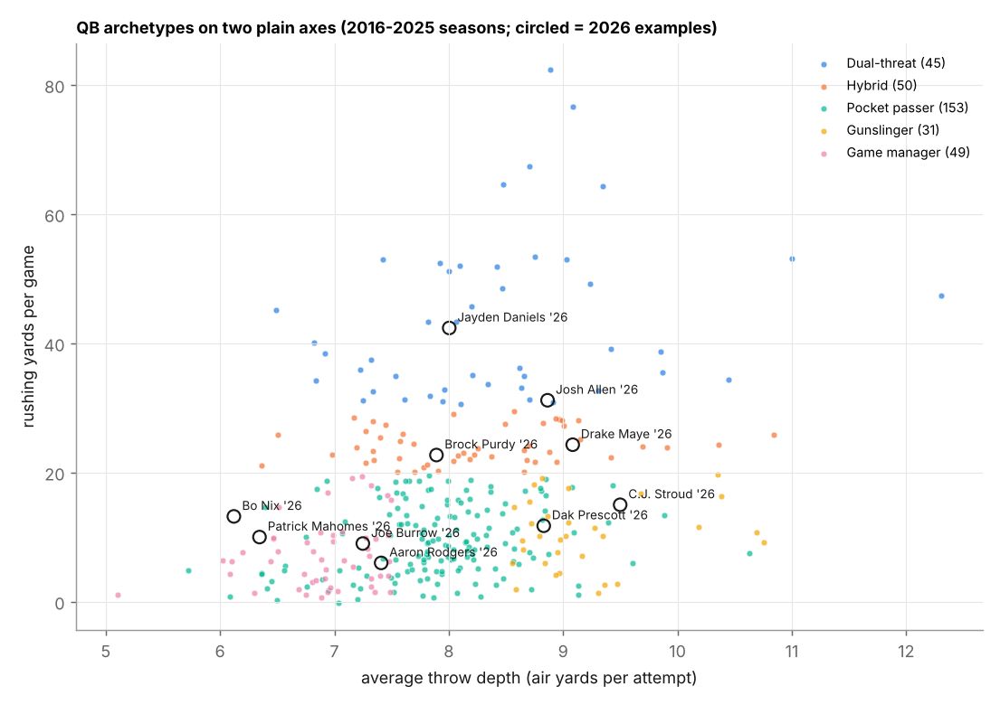
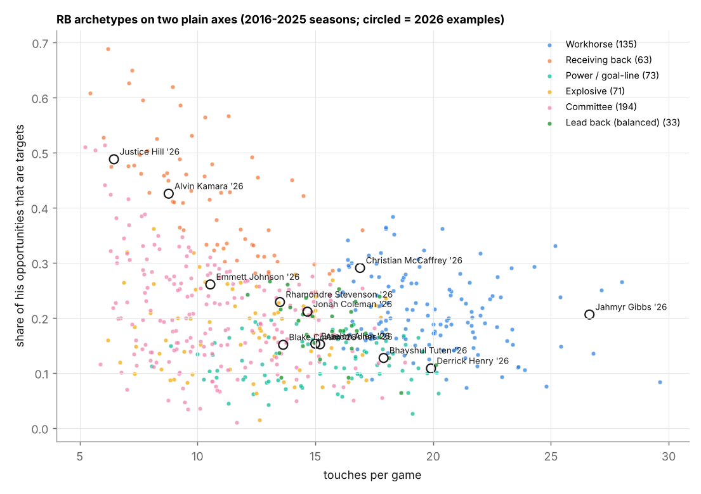
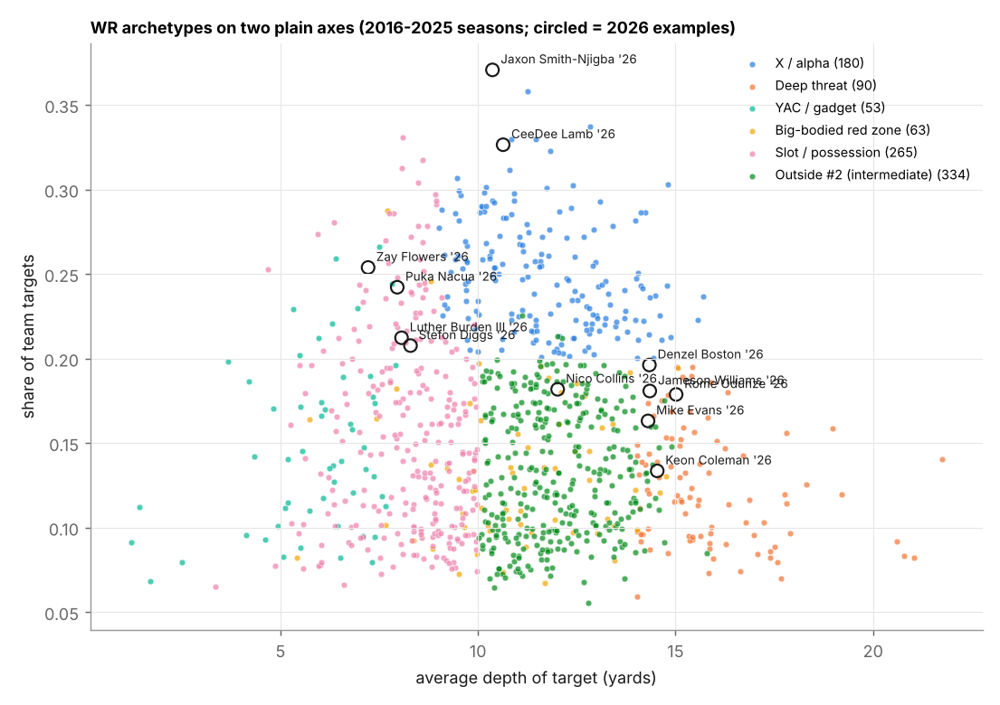
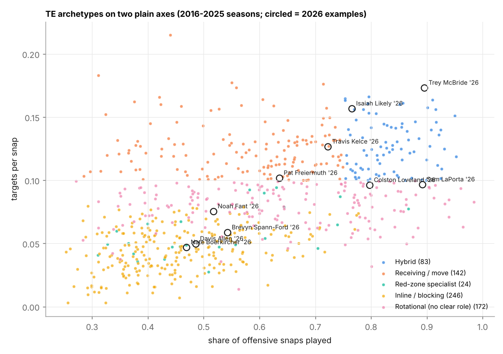

What they show: the groups sit next to each other along sliding scales, with no empty gaps between them.

### 3b. Feature profiles (what makes each label different)

Median within-position percentile of each input for each label (50 = typical player at the position).

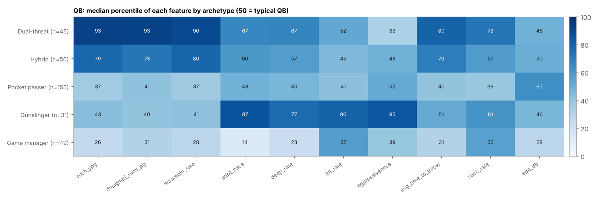
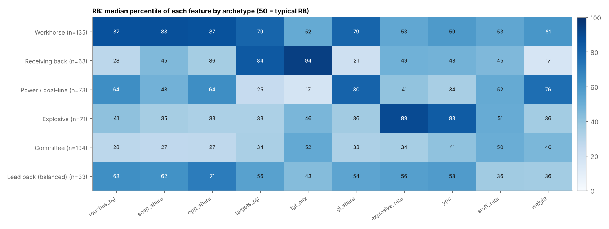
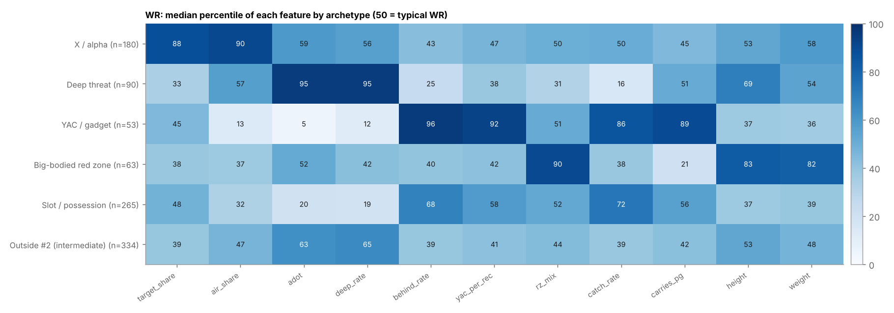
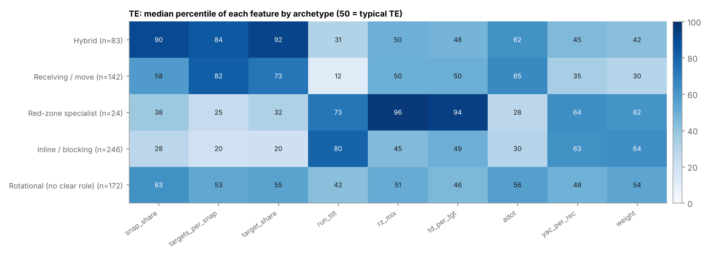

### 3c. Rule labels vs unsupervised clustering

Left: our labels on the two main directions of variation (PCA). Right: k-means with the same number of groups and no
labels given. Tables: `tables/{POS}_rules_vs_kmeans.csv`, cluster centers `tables/{POS}_kmeans_centers_z.csv`, and a
plain-threshold description of each k-means cluster `tables/{POS}_kmeans_tree_rules.txt`.

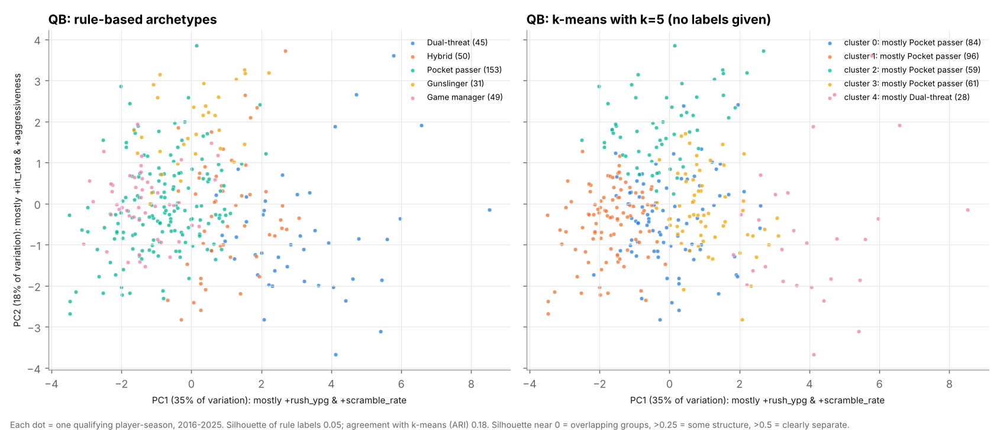
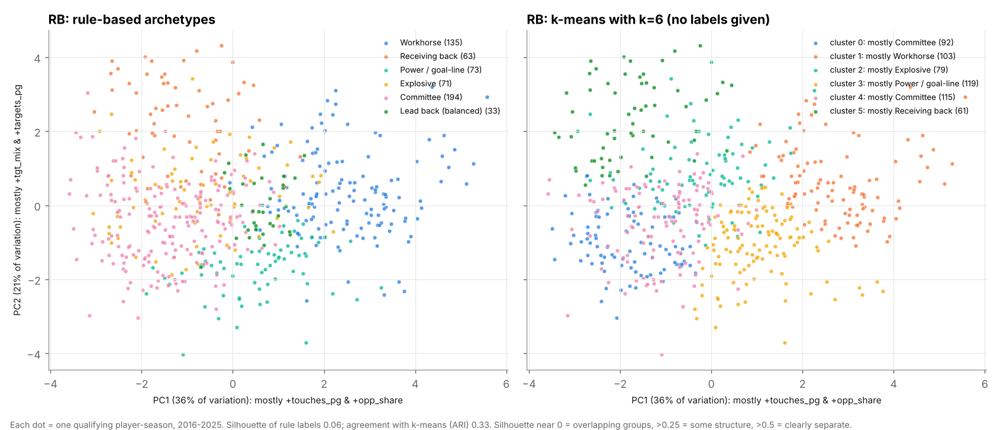
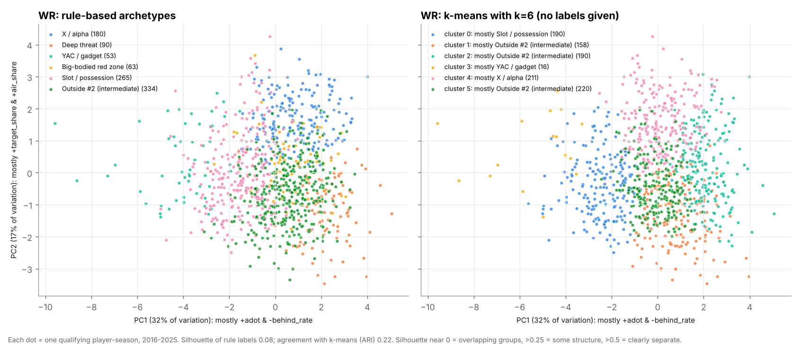
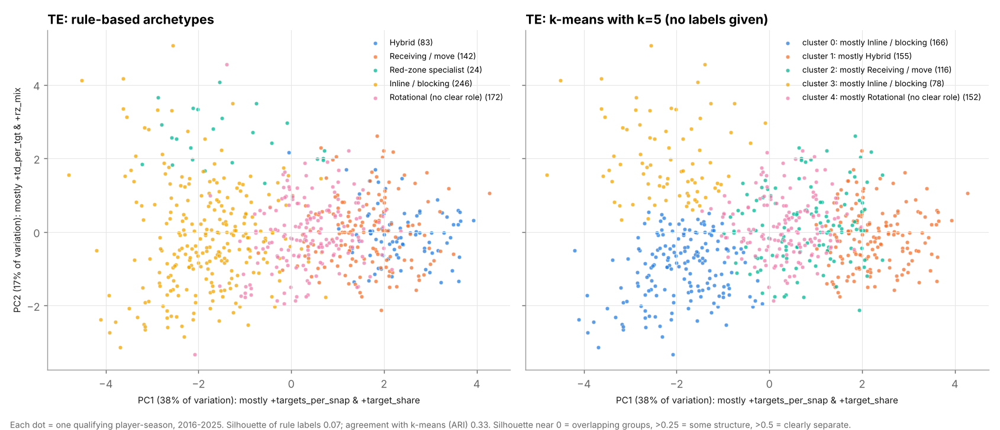

| Position | Seasons | Labels | Silhouette, our labels | Best k-means k (silhouette) | Gaussian mixture best k (BIC) | Agreement labels vs k-means (ARI) | Depth-3 tree recovers our labels | Depth-3 tree recovers k-means |
|---|---|---|---|---|---|---|---|---|
| QB | 328 | 5 | 0.05 | 2 (0.23) | 5 | 0.18 | 90% | 69% |
| RB | 569 | 6 | 0.06 | 2 (0.22) | 8 | 0.33 | 79% | 61% |
| WR | 985 | 6 | 0.08 | 2 (0.19) | 8 | 0.22 | 87% | 69% |
| TE | 667 | 5 | 0.07 | 2 (0.26) | 7 | 0.33 | 95% | 73% |

How to read it: silhouette near 0 = groups overlap, 0.25 = some structure, 0.5+ = clearly separate. ARI 0 = random
agreement, 1 = identical. Our labels are **simple** (a three-question tree recovers them) but **not natural clusters**;
k-means clusters are less explainable (a three-question tree recovers only 61-73% of them).

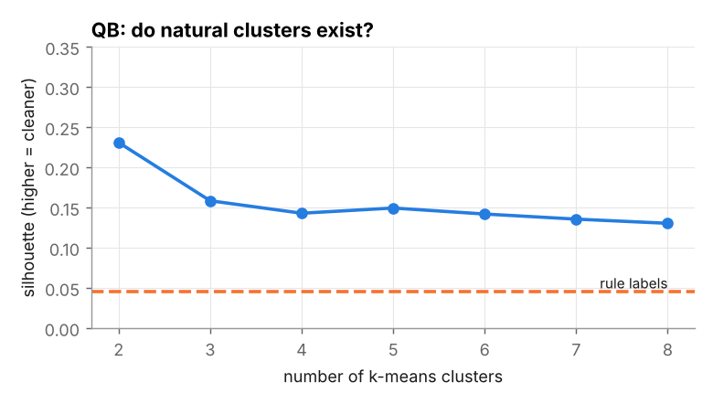 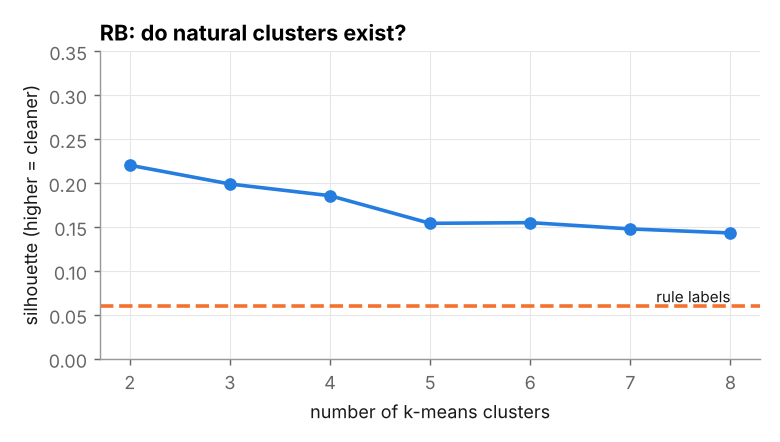
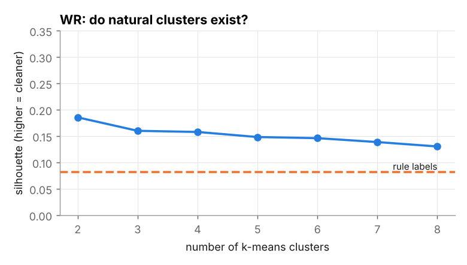 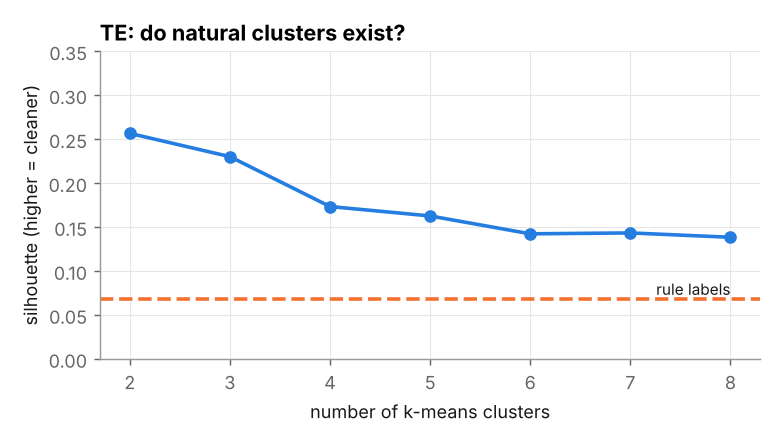

**The one natural split (k = 2), from `tables/{POS}_k2_centers_z.csv`:**

| Position | Cluster A | Cluster B | Matches label |
|---|---|---|---|
| QB | 107 seasons: +1.0 SD rushing yards, +1.0 SD scrambles, longer time to throw, more sacks | 221: little rushing | Dual-threat/Hybrid vs pocket |
| RB | 241: +0.9 SD touches, snaps, RB share, goal-line share | 328: low volume | Workhorse/lead vs committee |
| WR | 565: deeper aDOT (+0.6), more deep targets, taller, heavier | 420: short aDOT, screens, higher catch rate and YAC, smaller | Outside vs slot/possession |
| TE | 373: more snaps, targets/snap +0.7 SD, deeper aDOT, pass-tilted | 294: fewer targets, run-tilted | Receiving vs inline |

Style-only clustering (volume inputs removed) is no cleaner: best silhouette 0.19-0.27 at k = 2
(`tables/style_only_silhouette.csv`).

### 3d. Is an archetype a stable trait? (same player, next season)

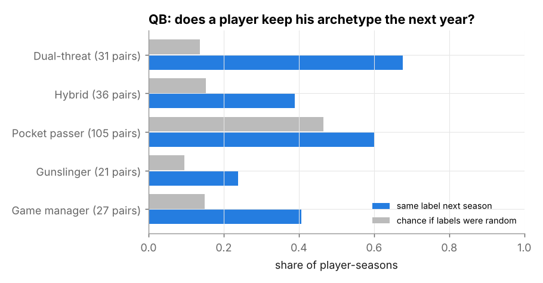
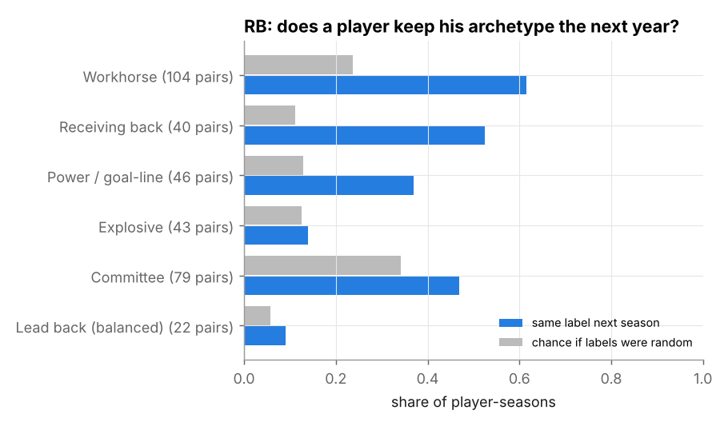
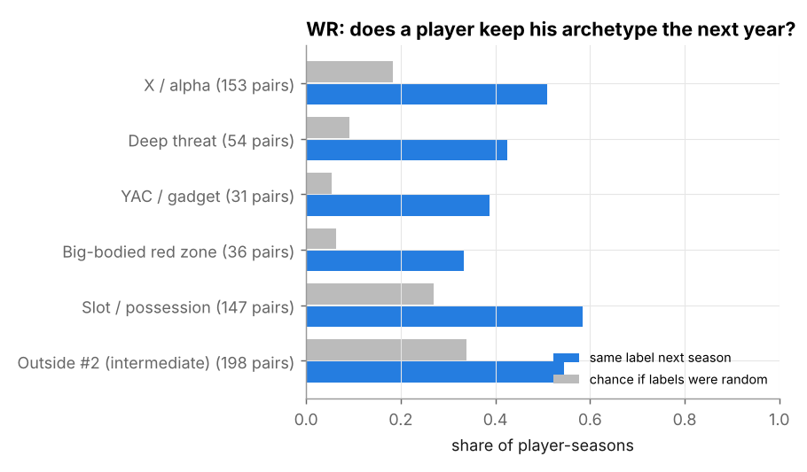
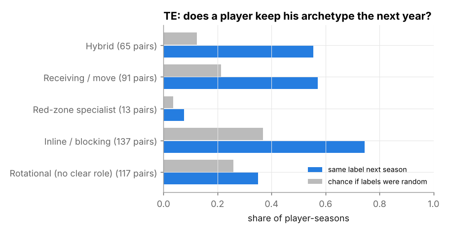

| Position | Same label next season | Chance | Most stable | Least stable (about chance) |
|---|---|---|---|---|
| QB | 52% | 29% | Dual-threat 68% (chance 14%) | Gunslinger 24% (10%), Hybrid 39% |
| RB | 44% | 22% | Workhorse 62% (24%), Receiving 53% (11%) | Explosive 14% (13%), Lead back 9% (6%) |
| WR | 52% | 24% | Slot/possession 59%, X/alpha 51% (18%) | Big red zone 33% (6%) |
| TE | 55% | 27% | Inline 75% (37%), Receiving 57%, Hybrid 55% (12%) | Red-zone specialist 8% (4%) |

Full next-season transition tables: `tables/{POS}_transition_next_season.csv`. (Changes also include team changes,
injuries and aging, so some movement is real, not noise.)

---

## 4. College prospects vs NFL players: what can be measured where

| Input | NFL (2016+) | College (our tables) | Note |
|---|---|---|---|
| Rushing yards, carries, rush share (QB) | Yes | Yes (`rush_yds`, `rush_yds_share`) | |
| Designed runs vs scrambles | Yes | No (needs cfbfastR play-by-play) | |
| aDOT, deep rate, behind-line rate | Yes | **No** (college play-by-play has no reliable air yards) | Biggest gap for WR/QB style |
| INT rate, YPA, completion % | Yes | Yes | |
| Tight-window %, time to throw | Yes (NGS) | No | |
| EPA/dropback | Yes | Partly (`ppa_pass`, 2014+) | |
| Snap share, targets/snap, run tilt | Yes | **No** (no college snap or participation data) | Biggest gap for TE and RB role |
| Opportunity share, target mix (RB) | Yes | Yes as shares (`car_share`, `rec_share`, `rec_yds_share`) | |
| Goal-line share | Yes | No (needs cfbfastR play-by-play, `yards_to_goal`) | Possible to add |
| Explosive run rate | Yes | No (needs play-by-play); YPC as a proxy | |
| Target share, air-yards share | Yes / Yes | Receptions and yards share only (`rec_share`, `yds_share`, dominator) | |
| YAC/catch | Yes | No | |
| Red-zone mix | Yes | No (TD share as a proxy) | |
| Slot rate / alignment | **No (not public; PFF)** | No | Slot/possession uses aDOT as a stand-in |
| Height, weight, 40 time | Yes | Yes (combine) | |

**Can the NFL label be read from the final college season?** Drafted players with a qualifying NFL season in years 1-3;
AUC 0.5 = no signal, 0.7 = useful, 0.8+ = strong (`tables/college_proxy_auc.csv`):

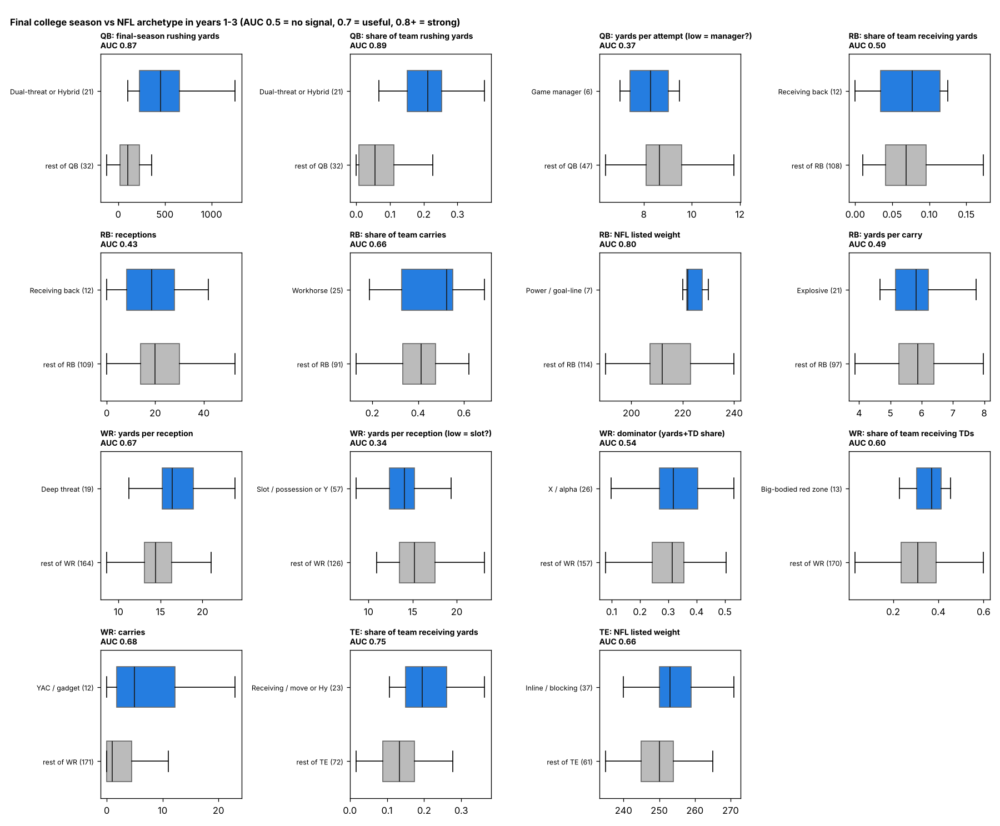

| NFL label (years 1-3) | College proxy | n (positives) | AUC |
|---|---|---|---|
| QB dual-threat or hybrid | share of team rushing yards | 53 (21) | **0.89** |
| QB dual-threat or hybrid | rushing yards | 53 (21) | **0.87** |
| RB power / goal-line | listed weight | 121 (7) | 0.80 (tiny n) |
| TE receiving or hybrid | share of team receiving yards | 95 (23) | 0.75 |
| WR YAC / gadget | college carries | 183 (12) | 0.68 |
| WR deep threat | yards per catch | 183 (19) | 0.67 |
| RB workhorse | share of team carries | 116 (25) | 0.66 |
| TE inline | listed weight | 98 (37) | 0.66 |
| WR big red zone | share of team receiving TDs | 183 (13) | 0.60 |
| WR X / alpha | dominator | 183 (26) | 0.55 |
| RB explosive | yards per carry | 118 (21) | 0.49 |
| RB receiving back | share of team receiving yards | 120 (12) | **0.50** |
| QB game manager | yards per attempt | 53 (6) | below 0.5 (reversed, n = 6) |

This is a label check only (does the same role show up in both places), not a value test.

---

## 5. APPROVED version (Kyle 2026-11-28): two layers (role x style)

The single-label version mixes "how much" with "how". The two-layer version tags every qualifying season twice
(both already computed in `ar_labels_*.csv` as `role_layer` and `style_layer`):

| Position | Role layer (how much) | Style layer (how) |
|---|---|---|
| QB | Runner (rush >= 30/g), Mobile (20-30), Pocket (< 20) | Gunslinger, Game manager, Pocket passer (rules as above) |
| RB | Workhorse (snaps >= 60% and 16+ touches/g), Lead (RB opportunity share >= 50%), Committee | Receiving (3+ targets/g and target mix >= 25%), Power (goal-line share >= 45% or 225+ lb), Balanced (Explosive dropped 11-28) |
| WR | Alpha (target share >= 22%), Starter (15-22%), Rotational (< 15%) | Deep, YAC/gadget, Big red zone, Short/slot (aDOT < 10), Intermediate outside |
| TE | Every-down (snaps >= 75%), Regular (50-75%), Part-time (< 50%) | Receiver (targets/snap >= 0.10), Blocker (run tilt), Balanced (Red zone dropped 11-28) |

So Chase 2024 = "Alpha, Short/slot"; St. Brown 2022 = "Alpha, YAC/gadget"; Kittle = "Every-down, Receiver".

Stability (same player next season, kappa: 0 = chance, 1 = always the same; `tables/two_layer_persistence.csv`):

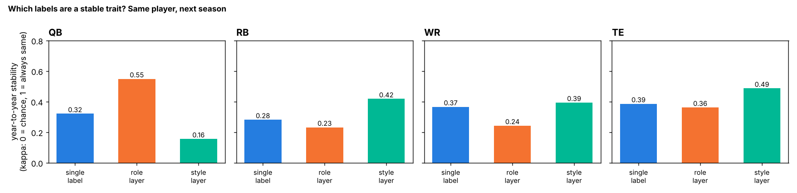

| Position | Single label | Role layer | Style layer |
|---|---|---|---|
| QB | 0.32 | **0.55** | 0.16 |
| RB | 0.28 | 0.23 | **0.39** (0.42 approved, Explosive dropped) |
| WR | 0.37 | 0.24 | **0.39** |
| TE | 0.39 | 0.36 | **0.44** (0.49 approved, Red zone dropped) |

Role changes more from year to year than style (depth charts, injuries), which is what you would expect and is why
mixing them in one label makes labels flip. QB passing style is not a stable trait; QB rushing is.

---

## 6. Possible problems, solutions, recommendations

| # | Problem | Effect | Solution / recommendation |
|---|---|---|---|
| 1 | No natural clusters (silhouette <= 0.26) | Players near a cut flip labels; labels are descriptive, not "types" | Show the two-axis maps with labels; in step 2 test the underlying inputs (continuous) alongside the labels, so labels are not credited with signal the inputs carry |
| 2 | Explosive RB, balanced lead back, red-zone TE, gunslinger are near-chance year to year | Mostly one-season noise (big-play and TD rates are small samples) | Drop explosive and red-zone TE as stand-alone labels or require 2 seasons; fold "lead back" into the role layer |
| 3 | Slot rate, routes run, alignment are not public | "Slot" is really "short aDOT"; TPRR uses targets per snap; TE hybrid vs move uses snap share, not blocking | Say so in every write-up; FTN/PFF alignment data would fix it but is paid (do not scrape) |
| 4 | No blocking grades | Hybrid TE = every-down TE with targets; Kelce lands in Hybrid some years, Receiving others | Label accepted as "every-down receiver"; call it that in plain English |
| 5 | 2026 has no participation file | Run tilt missing in 2026; inline TE uses a stricter targets/snap fallback | Recompute when nflverse posts 2026 participation |
| 6 | Positions from the roster file | Taysom Hill is a TE (shows as Inline 2020/22); some gadget players misfit | Add a manual exception list if labels go public |
| 7 | Thresholds are set on the same data they are tested on | Separation and stability numbers are slightly optimistic | Freeze the thresholds before step 2 and test on 2024-2025 out of sample |
| 8 | College data cannot see RB receiving role, aDOT or snaps | Pre-draft archetypes only work for QB rushing, TE receiving share, size-based labels | If step 2 needs prospect archetypes: pull cfbfastR play-by-play (goal-line share, explosive runs, target depth where charted) |
| 9 | Python, not R | Kyle's PC pipeline is R | Research only; port to R only if a label goes live |
| 10 | Thresholds are judgment calls near percentiles | Different cuts give different counts | `ar_03_rules.py` keeps every threshold in one place; tweak and rerun in seconds |

**Next step (after Kyle approves definitions):** step 2 tests whether archetypes add signal beyond the current models
(e.g. rookie tier odds, next-season PPG, aging and survival by archetype), with thresholds frozen first.
