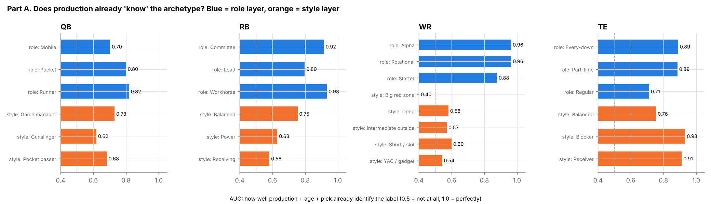
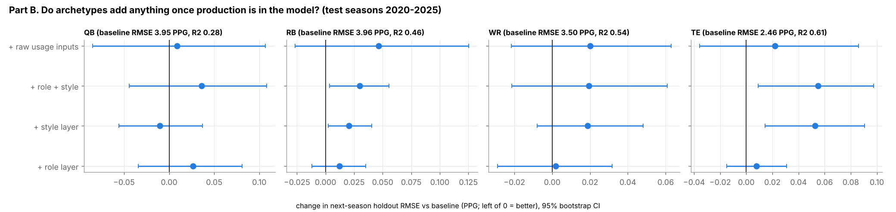
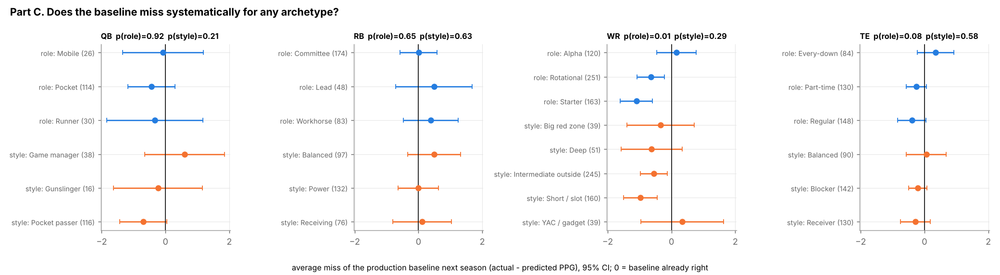

# Do archetypes double count production? (research, step 2)

Status: **RESEARCH ONLY**, 2026-11-28. Nothing live changed. Script: `ar_07_double_count.py`. Tables: `tables/dc_*.csv`.

**Kyle's hypothesis (11-28):** because the archetype definitions are built from production and usage stats, they will
double count with the production that our values already use.

**Answer: confirmed.** Production, age and draft pick already identify most of the role labels (AUC 0.80-0.96 for RB,
WR and TE). Adding archetypes to a production model does not improve next-season predictions for any position. The
best case is QB style, which is -0.01 PPG and not significant. Adding style hurt RB and TE slightly but significantly,
by +0.02 and +0.05 PPG RMSE. Adding the raw usage inputs behind the labels does not help either. The one possible lead
is that the production baseline under-predicts alpha WRs and every-down TEs by about +0.6 to +0.7 PPG (p = .03-.05).
That looks like a "top players regress less" curve rather than an archetype effect.

---

## Design

- **Labels:** the approved version: two layers per season, role (how much) x style (how). Explosive RB and red-zone
  TE are dropped (folded into Balanced). Rules in `ar_03_rules.py` `two_layer()`. See [ARCHETYPES.md](ARCHETYPES.md).
- **Baseline = what the live values already know.** This season's PPG and games, last season's PPG and games (or a
  "no prior season" flag), age, log draft pick and an undrafted flag. These are the credible-PPG inputs plus the
  aging and draft-pick prior. A ridge regression learns the weights, so the baseline is at least as flexible as the
  live blend. It is a stand-in, not the exact live formula.
- **Target:** next season's PPR points per game, for next seasons with 4+ games. The 2026 target is weeks 1-12.
- **Holdout:** rolling origin. Each test season from 2020 to 2025 is predicted by a model trained only on earlier
  seasons. The 95% intervals come from a paired bootstrap that resamples players.
- **Three questions:**
  - **A.** How much of each label can production already identify? (5-fold logistic regression on the baseline, one AUC per label)
  - **B.** Do the labels lower holdout error once production is in the model?
  - **C.** Does the baseline miss in the same direction for any archetype? (residual means, ANOVA)

---

## A. Production already "knows" the role layer

| Position | Role layer AUC | Style layer AUC |
|---|---|---|
| QB | 0.70-0.82 | 0.62-0.73 |
| RB | 0.80-0.93 | 0.58-0.75 |
| WR | 0.88-0.96 | 0.40-0.60 (mostly near chance) |
| TE | 0.71-0.89 | 0.76-0.93 (receiver vs blocker is mostly volume) |

How to read it: 0.5 means production cannot tell the label apart, and 1.0 means it identifies the label perfectly.
WR "big red zone" scores 0.40, meaning these players have slightly lower production than other WRs (0.60 read the
other way round). The **role layer is mostly a restatement of production.** The **WR and RB style layers are new
information**: production barely knows them. The next part shows that this new information does not predict next
season.

Table: `tables/dc_A_archetype_explained_by_production.csv`.

## B. No gain beyond production in the holdout

| Position (test seasons) | Baseline RMSE / R2 | + role | + style | + role + style | + raw usage inputs | Archetypes only |
|---|---|---|---|---|---|---|
| QB (170) | 3.95 / 0.28 | +0.03 | -0.01 | +0.04 | +0.01 | +0.41 |
| RB (305) | 3.96 / 0.46 | +0.01 | **+0.02*** | **+0.03*** | +0.05 | +0.73* |
| WR (534) | 3.50 / 0.54 | +0.00 | +0.02 | +0.02 | +0.02 | +0.72* |
| TE (362) | 2.46 / 0.61 | +0.01 | **+0.05*** | **+0.05*** | +0.02 | +0.52* |

Each cell is the change in RMSE against the baseline, in PPG. Negative means better. A * means the 95% interval
excludes 0. Spearman rank correlation tells the same story: baseline 0.57 / 0.67 / 0.74 / 0.77, and every add-on is
within 0.01 of that, or lower.

"Archetypes only" shows the labels without any production. They carry real signal on their own (R2 0.13-0.43), but it
is the same signal production already carries.

Robustness check with gradient boosting (nonlinear, `tables/dc_robust_gradient_boosting.csv`): adding role + style
improves the boosted model by 0.01-0.08 PPG. However, every boosted model is worse than the plain ridge baseline: QB
3.93 vs 3.95 is a tie, and RB, WR and TE are worse by 0.15-0.31. So there is no gain against the better baseline.

Table: `tables/dc_B_holdout_next_season_ppg.csv`.

## C. Where the baseline misses

The chart above includes 2025 → 2026, a partial season. Every group sits slightly below 0 in that version, because
2026 PPG so far runs lower than the model expects. Centring each test season and dropping the partial 2026 target
(`tables/dc_C2_residual_centred_2020_2024.csv`) gives:

| Group | Baseline miss next season | p (layer) |
|---|---|---|
| WR Alpha | **+0.68 PPG** (±0.66) | .03 |
| WR Starter | -0.44 (±0.52) | |
| TE Every-down | **+0.64 PPG** (±0.66) | .05 |
| QB, RB (any layer), WR style, TE style | all within noise | .16-.80 |

This is 8 layer tests, so p = .03-.05 is a lead, not a finding. It also has a simpler explanation than archetypes: the
best producers regress to the mean less than a straight-line model assumes. Role dummies did not fix it in Part B,
which points to curvature in PPG rather than the label.

---

## What this means

1. **For player values (the live trade values): do not add archetypes.** They double count production, as Kyle
   expected, and they add no holdout accuracy.
2. **Keep archetypes as a description layer.** They help explain a player to a non-technical reader ("an alpha
   short/slot receiver"). Show them as tags, not as value inputs.
3. **Where archetypes could still matter (not tested here):**
   - **Rookie and prospect models.** There is no NFL production to double count there, but labels would have to
     come from college stats. Only QB rushing (AUC 0.89) and TE receiving share (0.75) are readable from college
     stats (ARCHETYPES.md section 4). Model parity would apply.
   - **Aging and survival curves by style**, for example whether receiving backs age better than power backs.
     These are longer-run outcomes that a next-season PPG test does not cover.
   - **The "top players regress less" lead from Part C.** Test it as a curve on PPG, not as an archetype.

## Possible problems

| Problem | Effect | Solution |
|---|---|---|
| The baseline is a ridge stand-in, not the live credible-PPG formula | The live formula could be weaker than the stand-in, which would leave room for archetypes | Rerun Part B with the live credible PPG as the only production input, using the R pipeline on the PC |
| Only next-season PPG was tested, not games played, multi-year value or survival | Archetypes might matter for durability or aging | Run the R44 aging and survival test if Kyle wants it |
| Season-level labels for veterans | Single-season labels are noisy (ARCHETYPES.md 3d) | Multi-season labels; likely the same result, since the role layer is mostly production |
| Small QB sample (170 test seasons) | Wide intervals | Pool seasons or wait for more data |
| 2026 target is partial (weeks 1-12) | Every group shows a small negative shift in Part C | Centred check excludes it; rerun after week 18 |
