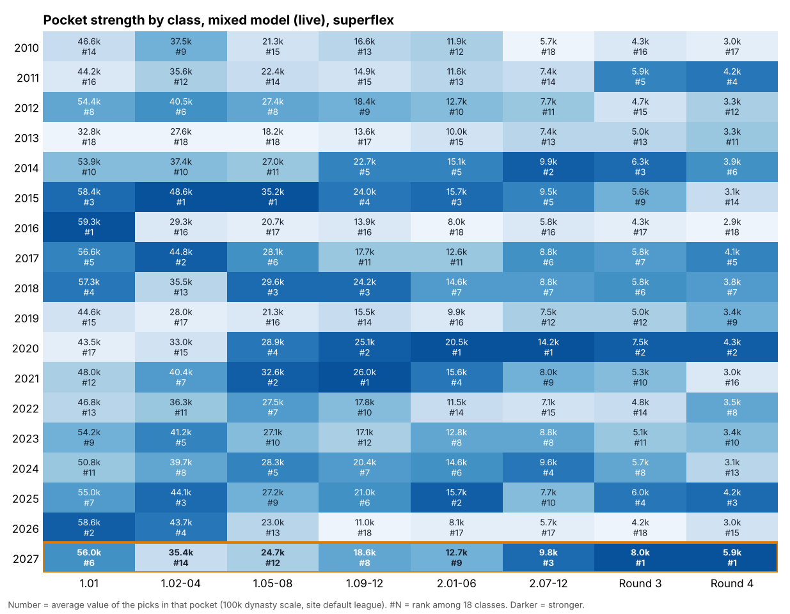
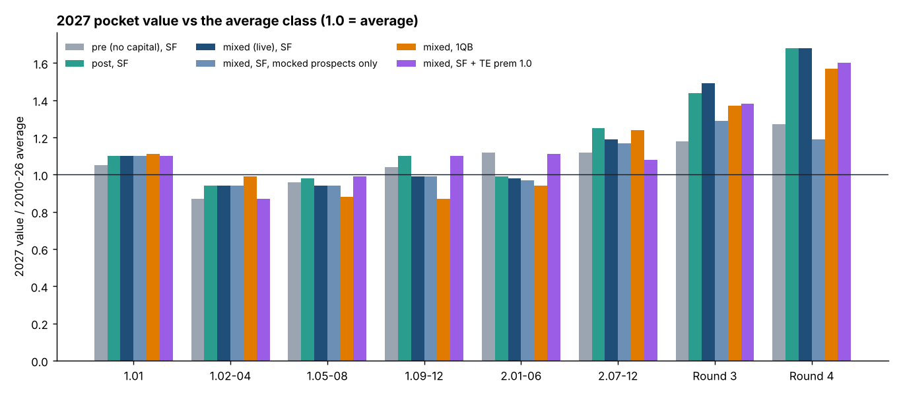
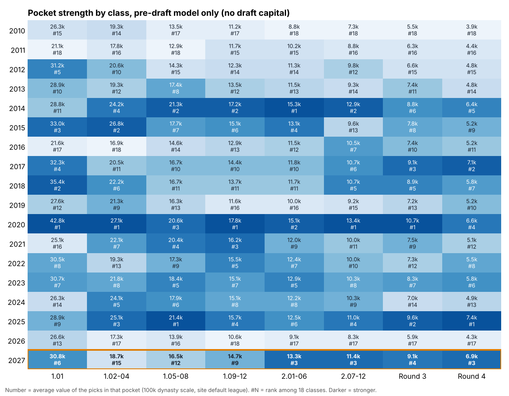
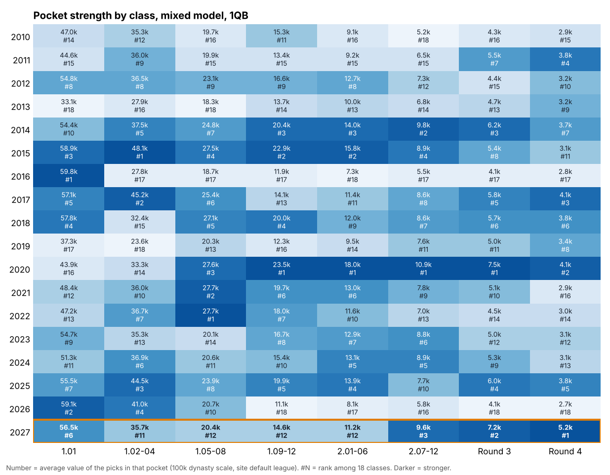
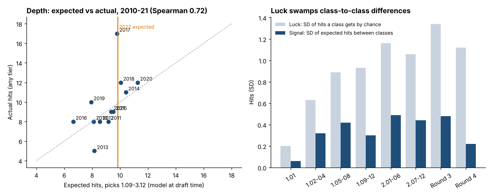
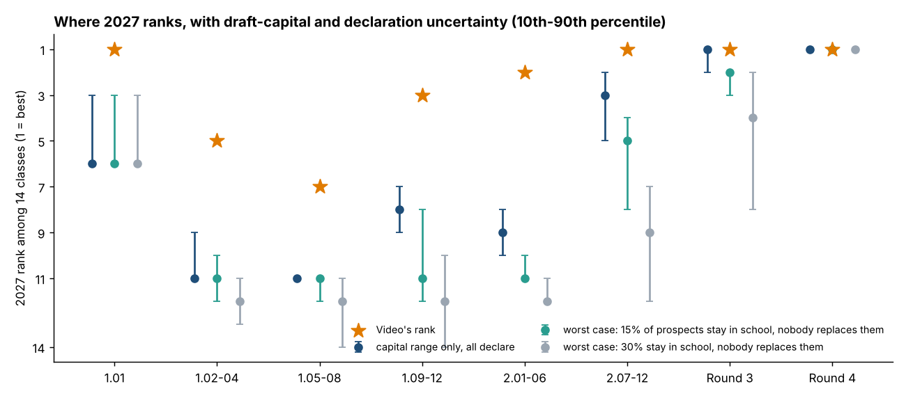
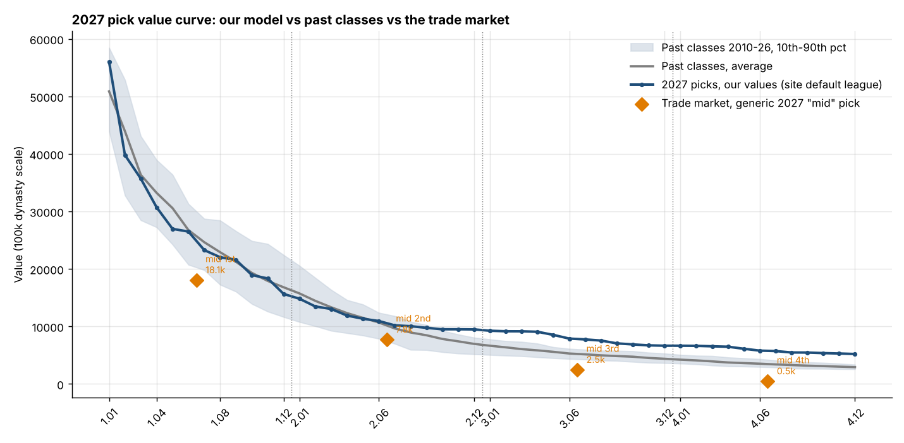
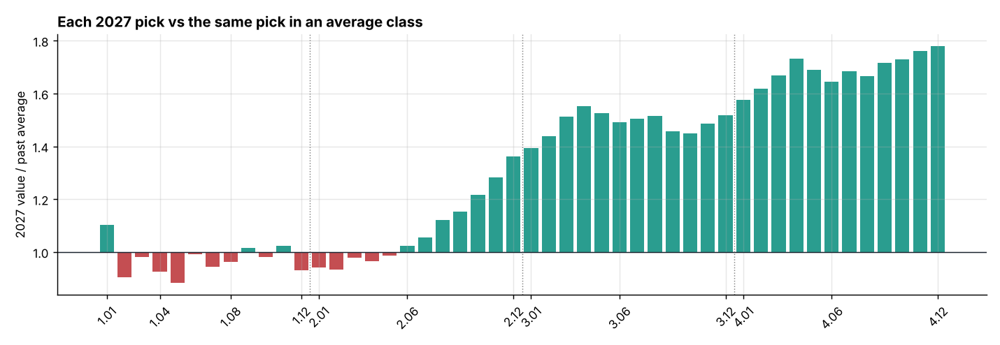
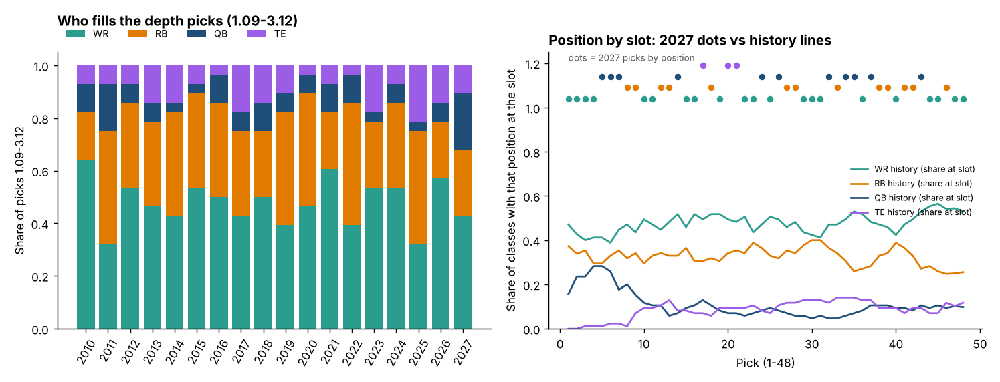

# 2027 rookie pick pockets: does our data back the "2027 picks are gold" claims?

Research only (Kyle, 2026-11-25). Nothing on the site changed.

Kyle shared a summary of a Dynasty Domain video ("2027 Picks Are GOLD In Dynasty") that ranks the 2027 class against the
previous 13 classes by rookie-draft pocket: **1.01 S-tier, 1.02-04 5th, 1.05-08 7th, 1.09-12 3rd, 2.01-06 2nd,
2.07-12 1st, Round 3 / early Round 4 about 1st**, says the depth is WR-driven (2025 was RB-driven), and recommends
buying 2027 seconds and collecting thirds/fourths as throw-ins. We treated each claim as a hypothesis and tested it with
our own models.

## Short answer

| Pocket | Video | Our mixed model (live), superflex | Verdict |
|---|---|---|---|
| 1.01 | S-tier | Jeremiah Smith 56.0k vs 50.9k for an average 1.01 (1.10x), **6th of 14** (6th of 18) | Agree: a strong 1.01, not a record one |
| 1.02-04 | 5th | 0.94x, **11th of 14** | **Disagree:** below average (Becker, Coleman, Marsh) |
| 1.05-08 | 7th (weak) | 0.94x, **11th** (1QB 0.88x) | Agree it is the weak spot, and weaker than the video says; it is QB-heavy |
| 1.09-12 | 3rd | 0.99x, **8th** | **Disagree:** average |
| 2.01-06 | 2nd | 0.98x, **9th** | **Disagree:** average |
| 2.07-12 | 1st | 1.19x, **3rd** | Agree: strong |
| Round 3 | ~1st | 1.49x, **1st** (1.29x, 2nd without unmocked prospects) | Agree |
| Round 4 | ~1st | 1.68x, **1st** (1.19x, 3rd without unmocked prospects) | Agree, but the least certain number |

"Of 14" = rank among 2014-2026 plus 2027 (the video's 13 comparison classes). Value = average value of the picks in the
pocket on the site's 100k dynasty scale, site default league.

**Where we land:** the 2027 class is top-heavy at 1.01, a little *below* average from 1.02 to 1.08, average from 1.09 to
2.06, and clearly above average from **2.07 through 4.12**. The depth starts about half a round later than the video says.
The depth is **not WR-driven** in our numbers: 2027's picks 1.09-3.12 are 43% WR (history 48%) and 21% QB (history ~8%);
the WRs are at the top (1.01-1.04 are all WRs). The video's 2025 = RB-driven claim checks out (2025 had 43% RBs).

## Method

- **Data.** Every drafted QB/RB/WR/TE 2010-2026 and the 2027 board (Kyle's four mocks, median pick; prospects no mock
  drafts priced with pre-draft odds x P(declare), exactly as the site does). Three model lenses:
  - **pre:** pre-draft model only (drafted-recalibrated odds, no draft capital). 2027 prospects weighted by the share of
    Kyle's mocks that draft them (mocked) or P(declare) (unmocked), so every class holds ~80 expected draftees.
  - **post:** plain post-draft model at the actual NFL pick (history) or the mock median pick (2027).
  - **mixed:** the live model (post + pre-draft faller boost). This is what the site's pick values use.
- **Values.** Every prospect is priced with the site's own engine (`shared/engine.js`, `prospectValue`: tier odds x tier
  PPG with the age adjustment, today's 100k dynasty scale) in four leagues: site default (12 teams, SF, PPR, 2 FLEX),
  1QB, SF + TE premium 1.0, and the trade-market page's league. Check: our 2027 slot values reproduce the site's
  1.01-4.12 pick values (same values, within 1.2k at a few slots because of age rounding).
- **Pockets.** In each class, sort prospects by value; pick k = the k-th best (that is how the site prices picks). Pockets
  1.01, 1.02-04, 1.05-08, 1.09-12, 2.01-06, 2.07-12, Round 3, Round 4. Metrics: mean value, expected top-tier and
  any-tier hits (sum of the model's odds).
- **Validation (ATPA: out-of-sample check).** For 2010-2021 (LOCO grades, 3+ NFL seasons): does a class's expected hit
  count in a pocket predict its actual hit count? Plus a Poisson-binomial simulation of how many hits a pocket gets by
  luck alone.
- **Uncertainty (Monte Carlo, 4,000 runs).** Draft capital: each mocked prospect lands at his best / median / worst mock
  pick (25/50/25%). Declarations: stress tests where 15% or 30% of prospects stay in school and nobody replaces them
  (Arch Manning, Ahmad Hardy, Austin Simmons at 50% because the video doubts them; Smith always declares).
- **Market.** The trade market (Dynasty Daddy Trade Database fit, `Trade_Market/`) has one generic "mid" price per 2027
  round. We put it on our scale by rank: if the market ranks the mid 1st as its 68th asset, it gets our 68th player's
  value. Dynasty Daddy's public values API lists **no rookie picks** (checked 2026-11-25), so there is no separate DD
  pick price.

## Results

### 1. Pocket strength vs past classes

`outputs/pocket_rank_2027.csv` has every view. 2027 rank among 14 by view:

| View | 1.01 | 1.02-04 | 1.05-08 | 1.09-12 | 2.01-06 | 2.07-12 | R3 | R4 |
|---|---|---|---|---|---|---|---|---|
| Video | S | 5 | 7 | 3 | 2 | 1 | ~1 | ~1 |
| Pre-draft only (no capital) | 5 | 12 | 11 | 9 | 3 | 3 | 4 | 3 |
| Post-draft (mock capital) | 6 | 11 | 10 | 7 | 9 | 2 | 1 | 1 |
| **Mixed (live)** | **6** | **11** | **11** | **8** | **9** | **3** | **1** | **1** |
| Mixed, mocked prospects only | 6 | 11 | 11 | 8 | 9 | 3 | 2 | 3 |
| Mixed, 1QB | 6 | 9 | 11 | 10 | 11 | 3 | 2 | 1 |
| Mixed, SF + TE premium 1.0 | 5 | 12 | 10 | 8 | 6 | 6 | 1 | 1 |

Every lens agrees on the shape: below average 1.02-1.08, strong from the late 2nd on. The pre-draft-only lens (closest to
a college-production model like the video's) is the only one that also likes 2.01-06 (3rd).

### 2. Is pocket strength even predictable? (realized check, 2010-2021)

| Pocket | Expected hits (avg) | Actual hits (avg) | Spearman expected vs actual across classes | Luck SD | Between-class SD of expected |
|---|---|---|---|---|---|
| 1.02-04 | 2.43 | 1.92 | .51 | 0.63 | 0.32 |
| 1.05-08 | 2.70 | 2.67 | .23 | 0.89 | 0.42 |
| 1.09-12 | 2.32 | 2.50 | .38 | 0.93 | 0.30 |
| 2.01-06 | 2.54 | 2.42 | .37 | 1.16 | 0.49 |
| 2.07-12 | 1.75 | 2.33 | .29 | 1.06 | 0.44 |
| Round 3 | 2.46 | 2.50 | .41 | 1.34 | 0.48 |
| Round 4 | 1.51 | 1.17 | .34 | 1.12 | 0.22 |
| **1.09-3.12 combined** | 9.08 | 9.75 | **.72** | | |

(12 classes, so each correlation is rough.) Inside a single 6-pick pocket, luck (SD ~1 hit) is two to three times
bigger than the real difference between classes (SD ~0.3-0.5 hits), so "2.07-12 ranks 1st of 13" is a weak signal on its
own. Added up over the whole depth range (1.09-3.12) the signal is real (Spearman .72). **2027's depth range expects 9.8
any-tier hits vs 9.0 for an average class: 5th of 18, about one extra hit.** Good, not historic.

### 3. Draft-capital and declaration uncertainty

| 2027 rank of 14 (median, 10th-90th pct) | 1.01 | 1.02-04 | 1.05-08 | 1.09-12 | 2.01-06 | 2.07-12 | R3 | R4 |
|---|---|---|---|---|---|---|---|---|
| Mock capital range, all declare | 6 (3-6) | 11 (9-11) | 11 | 8 (7-9) | 9 (8-10) | 3 (2-5) | 1 (1-2) | 1 |
| 15% stay in school, no replacements | 6 | 11 | 11 | 11 | 11 | 5 (4-8) | 2 (2-3) | 1 |
| 30% stay in school, no replacements | 6 | 12 | 12 | 13 | 12 | 9 (7-12) | 4 (2-8) | 1 |

The early and middle firsts are below average in every scenario. The late-2nd edge needs most prospects to declare; the
Round 3/4 edge survives even heavy losses. (The "no replacement" runs are a worst case: in reality the NFL still drafts
~80 skill players and others move up into the capital.)

### 4. The pick value curve: model vs history vs market

| Round | Our 2027 round average | Past classes' round average | Our 2027 mid pick (x.06-x.07) | Market generic "mid" pick, our scale | Market / our mid pick | Market price buys our 2027... |
|---|---|---|---|---|---|---|
| 1st | 28.0k | 28.7k | 24.9k | 18.1k | 0.73 | 1.11 |
| 2nd | 11.2k | 10.6k | 10.6k | 7.8k | 0.73 | 3.07 |
| 3rd | 8.0k | 5.4k | 7.8k | 2.5k | 0.32 | less than 4.12 |
| 4th | 5.9k | 3.5k | 5.8k | 0.5k | 0.09 | less than 4.12 |

(`outputs/curve_vs_market.csv` also has the trade-market page's own league; same pattern, ratios 0.65 / 0.61 / 0.24 / 0.06.)

- **Flatness.** Value kept from 1.06 to 2.02: 51% (past median 54%, 12th flattest of 18): **normal, not flat**. From 2.01
  to 2.12: 64% (median 47%), **flattest of 18**; 2.07 to 3.06 keeps 77% (flattest); 3.01 to 4.12 keeps 56% (flattest).
  So the flat part of the 2027 curve is late 2nd to Round 4, not mid 1st to early 2nd.
- **Market gap.** The market discounts 2027 firsts and seconds by the same ~27% vs our model, so seconds are **not
  specially cheap relative to firsts**. Thirds and fourths are where the market and our model disagree most: the market
  treats them as nearly worthless while our model rates the 2027 Round 3/4 as the strongest we have.

### 5. Position mix

| Pocket (count) | 2027 QB/RB/WR/TE | 2025 QB/RB/WR/TE | Average 2010-26 |
|---|---|---|---|
| 1.01-1.04 | 0/0/4/0 | 0/2/2/0 | 1.0/1.3/1.6/0 |
| 1.05-08 | 3/1/0/0 | 2/2/0/0 | 0.8/1.4/1.8/0.1 |
| 1.09-12 | 0/2/2/0 | 0/1/2/1 | 0.5/1.1/2.1/0.4 |
| 2.01-06 | 1/2/2/1 | 0/3/2/1 | 0.6/2.1/2.9/0.4 |
| 2.07-12 | 1/0/3/2 | 0/3/2/1 | 0.5/2.1/2.9/0.5 |
| Round 3 | 4/3/5/0 | 1/5/3/3 | 0.7/4.0/5.8/1.5 |
| Round 4 | 2/5/5/0 | 3/3/6/0 | 1.1/3.6/6.1/1.2 |

2027's WR strength is the top four picks. The depth leans QB (superflex boosts them) and is light on RBs and TEs. In
1QB the QBs drop out, 1.05-1.12 gets weaker (0.87-0.88x) and the late 2nd still ranks 3rd.

### 6. Names in the video (verified against our board)

`outputs/video_names_check.csv`. 29 of 31 names are on our 2027 board; Emmett Mosley V (Texas WR) and Jamal Roberts
(Missouri RB) are in the eligible pool but not on the 93-player board. Transcript spellings fixed: Jaden Ball = **Jadan
Baugh** (RB, Florida), Kanan Lacy = **Kewan Lacy**, Trade Green = **Trey'Dez Green** (TE, LSU), Amari Thomas = **Amare
Thomas**, Amarian Miller = **Omarion Miller**, Nick Harbor = **Nyck Harbor**, Deuce Robinson = **Duce Robinson**,
Hollywood Smothers = **Daylan Smothers**.

Biggest player disagreements (our slot, mixed SF): Cam Coleman 1.03 (video: late 1st/2nd); CJ Carr 1.05 and Trinidad
Chambliss 2.12 (video: deeper; SF QBs rise for us); Isaac Brown 3.04 (video: mid 1st; mocks have him at pick ~102);
Jamari Johnson 2.05 and Trey'Dez Green 2.09 (video: mid 1st); Dylan Riley 2.01 (video: deeper). Agreements: Smith 1.01,
Becker 1.02, Marsh 1.04, Baugh 1.08 / Lacy 1.09 (video early/mid 1st), KJ Duff 1.10 and Ryan Williams 1.11 (late 1st).

## What this means for 2027 picks (our data, superflex)

| Pick range | Video | Our data |
|---|---|---|
| 1.01 | Strong hold | Hold. Strong (6th of 18) but not unique; prior research: 1.01 beat its price 1.15x historically |
| 1.02-1.04 | Hold | Below-average pocket. Fine to sell at market price for an established starter if contending |
| 1.05-1.08 | Conditional | Weakest relative to price; mostly QBs. In 1QB, sell |
| 1.09-2.06 | Late 1st hold/buy; buy 2nds | Average, priced at average. No special edge either way |
| 2.07-2.12 | Buy | Agree: strongest relative pocket we can trust; buy at market price (~0.73x of our value) |
| Rounds 3-4 | Throw-ins | Strongly agree: our model rates them the best in our history and the market prices them near zero |

## Possible problems, and fixes

1. **2027 uses mock capital, history uses real picks.** A mock places players at consensus spots; real drafts scatter.
   The Monte Carlo covers the mock range, not surprise risers. Fix: rerun after the April draft (R4 already planned).
2. **Prospects no mock drafts are priced on pre-draft odds x P(declare), with no capital.** They lift 2027 Rounds 3-4
   (1.49x/1.68x vs 1.29x/1.19x without them). Treat the R3/R4 edge as "strong", not "record". Fix: price unmocked
   prospects at an undrafted / Day-3 capital assumption (needs pd_09 on the PC).
3. **Pocket = our model's rank, not real rookie ADP.** We have no historical ADP (KTC/MDDB off-limits). Our pockets answer
   "how good is the k-th best asset by our model", which is how the site prices picks.
4. **2027 ages default to 22.0 for most prospects** (no birthdates yet). Younger players would add value.
5. **Small samples.** 13-18 classes per pocket; luck dominates single pockets (section 2).
6. **Market is one generic "mid" price per round, fitted on May-November trades**, during the season when contenders sell
   picks. It cannot test early vs late within a round, or the video's "2027 picks fell from May" claim (needs the raw DD
   trades on the PC by month).
7. **Our late-pick values are means.** Historically the median Round 2-3 pick produced almost nothing (prior research);
   the market may price the median plus roster-spot cost. Our past late-round prices were honest on average (produced /
   price 1.06 round 2, 1.18 round 3, Rookie_Pick_Strategy).

## Recommendations

- Re-run this study after the NFL draft with real capital, then again after the 2028 rookie drafts (R4).
- If Kyle wants it on the site: a small "2027 class by pocket" strip on the rookie board (rank of 18 per pocket). Not built.
- Test the market-timing claim (2027 pick prices by month, May-Nov) from the raw DD trades on the PC.
- Give unmocked prospects a capital assumption before trusting Round 4 numbers.

## Files

- `pp_01_build.py` builds `outputs/pp_prospects.csv` (all prospects, three lenses).
- `pp_02_values.js` prices them with the site engine; writes `pp_values.csv`, `pp_site_pick_values.csv`, `pp_our_board.csv`,
  `pp_market.json`. Run `node pp_02_values.js <prospect-actuary dir>`.
- `pp_03_pockets.py` pockets, ranks, realized check, Monte Carlo, position mix (`pocket_by_class.csv`,
  `pocket_rank_2027.csv`, `realized_check.csv`, `luck_vs_signal.csv`, `mc_2027_ranks.csv`, `position_mix*.csv`,
  `slots_2027_by_view.csv`; charts 01-07).
- `pp_04_curve.py` value curve vs history and market (`curve_vs_market.csv`, `market_picks.csv`, `curve_flatness.csv`;
  charts 08-09).
- `pp_05_names.py` name check (`video_names_check.csv`).

Run order: `python3 pp_01_build.py && node pp_02_values.js ../../prospect-actuary/ && python3 pp_03_pockets.py && python3 pp_04_curve.py && python3 pp_05_names.py`
(needs pandas, numpy, scipy, matplotlib, node). The video itself is not stored here.
