# What drives the post-draft model, by position

This page explains which inputs matter most in each position's post-draft model, and by how
much. Back to the [Post-Draft README](README.md). For the college-only version, see
[the pre-draft predictors page](../PreDraft_Model/PREDICTORS.md).

**How to read it**

- **The model:** the "post" tier ladder from each position model (QB/RB/TE
  `*_phase4_finish_tiers.R`, WR `wr_phase6_tier_ladder.R`). It is an ordinal elastic net
  (ordinalNet, cumulative logit, alpha 0.5, parallel terms, lambda tuned by class-grouped
  CV) on college features + combine + age + log(pick) + landing spot (vacated share,
  incumbent production). Those scripts don't save the fitted model, so
  `pd_08_post_predictors.R` refits the final ladder on every 2010-2023 drafted player with
  the same features and preprocessing (median impute + missing flags, standardized on the
  training rows; WR also uses the athletic PCA of forty, vertical, broad jump and speed
  score).
- **Target:** best PPR finish in NFL years 1-3 as an ordered tier: top, middle, bottom or
  none (QB/RB/TE 8/16/24, WR 12/24/36). One set of coefficients covers all three cut points
  (parallel terms), so an input's effect is the same for "top tier" and "any tier". The
  probabilities below are P(any tier).
- **Permutation importance:** how much the in-sample AUC for P(any tier) drops when one input
  is shuffled (its missing-value flag is shuffled with it), averaged over 3 shuffles with
  seed 2026. A bigger drop means the model leans on it more. Small negative values are
  noise.
- **Odds per SD:** the ordinal coefficient on the standardized input, exponentiated. It is
  how much the odds of a tier season change when the input rises by one standard deviation
  of the 2010-2023 drafted players, holding the rest fixed. 2.0 means double the odds; 0.5
  means half. Sign check: a later pick (higher log pick) lowers the odds at every position,
  as it should.
- **Partial dependence (PDP):** the average P(any tier) as the input moves from its 5th to
  its 95th percentile (0 vs 1 for yes/no inputs), holding everything else at each player's
  own values. The grey ICE lines never cross because the model is additive in log-odds.
- **SHAP:** each input's exact linear contribution to one player's log-odds, beta × (x −
  mean), with the missing flag added to its input. The plots rank inputs by mean |SHAP|.
- **Elastic net zeroes out most inputs.** Anything not in a table below has a coefficient
  of exactly 0 at the tuned lambda.

| Position | Model | Training n (drafted 2010-2023) | Hits (top / top two / any tier) | Inputs kept | In-sample AUC (any tier) |
|---|---|---|---|---|---|
| WR | Ordinal elastic net | 445 | 39 / 68 / 95 | 9 of 34 | 0.85 |
| QB | Ordinal elastic net | 163 | 21 / 32 / 45 | 13 of 47 | 0.94 |
| RB | Ordinal elastic net | 298 | 36 / 56 / 78 | 11 of 55 | 0.84 |
| TE | Ordinal elastic net | 202 | 22 / 42 / 55 | 18 of 51 | 0.90 |

"Inputs" counts model columns, including missing-value flags and the two WR athletic
components.

---

## Draft capital dominates

At every position, log(pick) is the biggest input by a wide margin. Shuffling it costs 5 to
38 times as much AUC as shuffling the next input, and it carries 38-64% of the total mean
|SHAP|.

| Position | Odds per SD of log pick | One SD of log pick ≈ | AUC drop: pick vs next input | Share of mean \|SHAP\| | P(any tier): pick 10 / 32 / 100 / 200 |
|---|---|---|---|---|---|
| WR | x0.43 | x2.5 in pick number | 0.256 vs 0.007 | 61% | 64% / 38% / 17% / 10% |
| QB | x0.38 | x5.2 in pick number | 0.199 vs 0.040 | 39% | 44% / 30% / 19% / 14% |
| RB | x0.34 | x2.2 in pick number | 0.273 vs 0.016 | 64% | 88% / 61% / 26% / 13% |
| TE | x0.40 | x2.0 in pick number | 0.181 vs 0.017 | 38% | 85% / 58% / 26% / 13% |

The college profile adds the most for QBs (completion % and rushing) and the least for WRs,
where only small age and athleticism effects survive once the pick is known. This matches
the validation on the [post-draft grades page](README.md): the post model beats pick-only
for QBs and is about level with it for RB, WR and TE.

---

## Wide receivers

**In one line:** an early pick, ideally a young early-declaring receiver who broke out early;
almost everything else is already priced into where he was drafted.

| Rank | Input | AUC drop | Odds per SD (any tier) |
|---|---|---|---|
| 1 | Draft pick (log) | 0.256 | x0.43 |
| 2 | Breakout age | 0.007 | x0.90 |
| 3 | Athletic PC1 (faster, jumps higher) | 0.004 | x0.94 |
| 4 | Early declare | 0.002 | x1.17 |
| 5 | Recruiting rating | 0.002 | x0.97 (missing flag only) |
| 6 | Age at draft | 0.001 | x0.96 |
| 7 | College seasons | 0.001 | x0.91 |
| 8 | Best-season dominator | 0.000 | x1.01 |
| 9 | Career receiving yards | 0.000 | x1.00 |

- **The pick is nearly the whole WR model.** Moving from pick 15 to pick 240 cuts P(WR36)
  from 55% to 9%. The next input costs only 0.007 AUC when shuffled.
- **Youth is the main college signal left.** An early breakout (x0.90 per SD of breakout
  age), early declaring (x1.17) and fewer college seasons (x0.91) all point the same way.
  Breakout age from 18.4 to 23.2 moves P(WR36) from 23% to 18%.
- **Athleticism is slightly negative given the pick.** PC1 loads on a faster forty and
  higher vertical and broad jumps. Its effect is x0.94 per SD (P(WR36) 23% to 20% across
  the range), because NFL teams already draft athletic receivers higher, so at the same pick
  the athletic one has a little less untapped value. Read it as "priced in", not "speed
  hurts".
- **Production inputs drop out.** Dominator rating, yards per team pass attempt and career
  yards, the core of the pre-draft WR model, are zeroed or near zero once the pick is in.
- **Landing spot doesn't help WRs:** vacated target share and team targets are both zeroed.

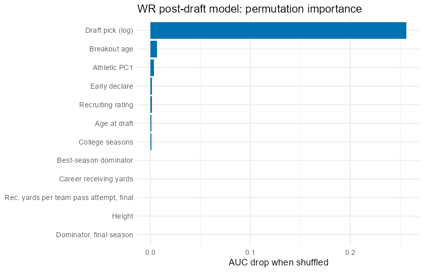
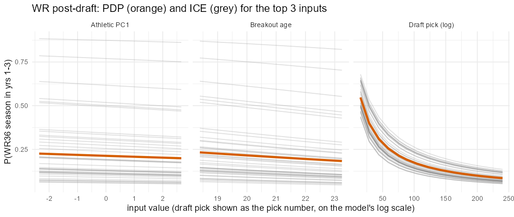
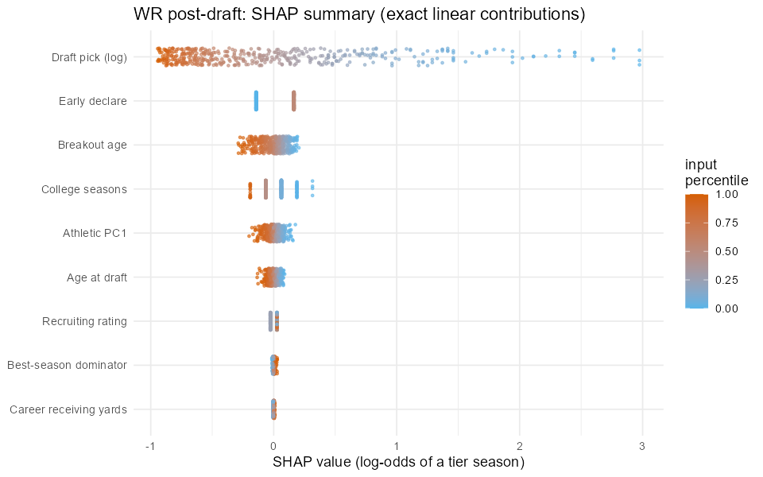

---

## Quarterbacks

**In one line:** an early pick who completed a high share of his passes, ran for real yards,
and became a starter young.

| Rank | Input | AUC drop | Odds per SD (any tier) |
|---|---|---|---|
| 1 | Draft pick (log) | 0.199 | x0.38 |
| 2 | Completion %, primary season | 0.040 | x1.61 |
| 3 | Incumbent's fantasy points | 0.013 | x0.82 (missing flag only, see note) |
| 4 | Age when he became a starter | 0.006 | x0.83 |
| 5 | Rushing yards, primary season | 0.005 | x1.31 |
| 6 | Career rushing yards | 0.002 | x1.23 |
| 7 | Transferred | 0.001 | x1.01 |
| 8 | Weight / height (missing flags) | 0.000 | x0.99 |
| 9 | Vacated pass-attempt share | -0.002 | x1.09 |
| 10 | Age at draft | -0.001 | x0.94 |

- **QB is where college stats add the most after the draft.** Completion % is the clear
  second input. Going from 56.8% to 72.4% moves P(QB24) from 17% to 39%, holding the pick
  fixed.
- **Rushing is a plus on top of the pick:** x1.31 per SD of primary-season rushing yards
  and x1.23 per SD of career rushing yards. Dual-threat QBs score more fantasy points than
  their draft slot suggests.
- **Young starters do better** (x0.83 per SD of the age he took over as starter).
- **"Incumbent's fantasy points" ranks 3rd only because of a data artifact.** The value
  itself has a coefficient of 0, and its PDP is flat (29% at 0 points and at 294 points).
  All of its importance comes from the missing flag (x0.82), which is set for 44 of 163
  QBs. These are most likely rows where the landing-spot join found a returning teammate with no
  recorded position, so the "max of returning QB points" became missing (Phase 2,
  `qb_phase2_targets_features.R`). Those QBs happened to hit less often (14% vs 33%). That
  reflects the data gap, not a football signal.
- **Pass efficiency drops out:** AY/A, TD rate and INT rate, which drive the pre-draft QB
  model, are zeroed once completion % and the pick are in.

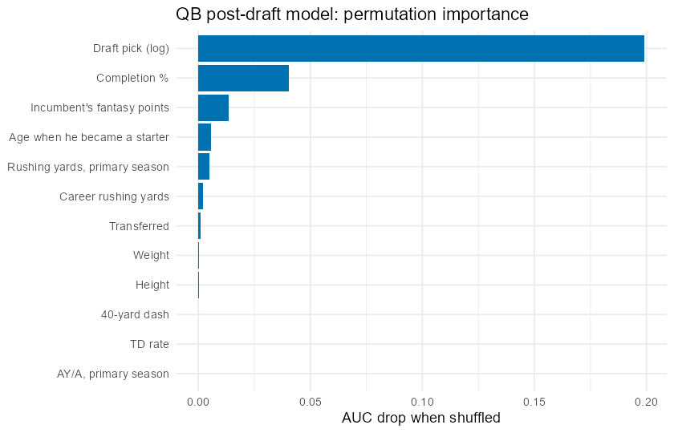
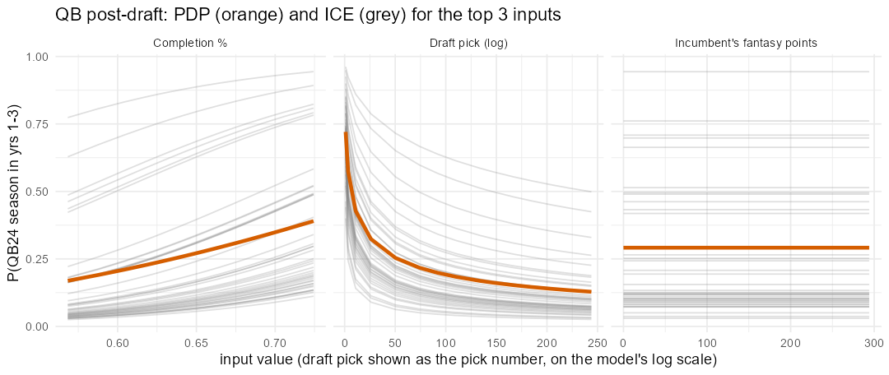
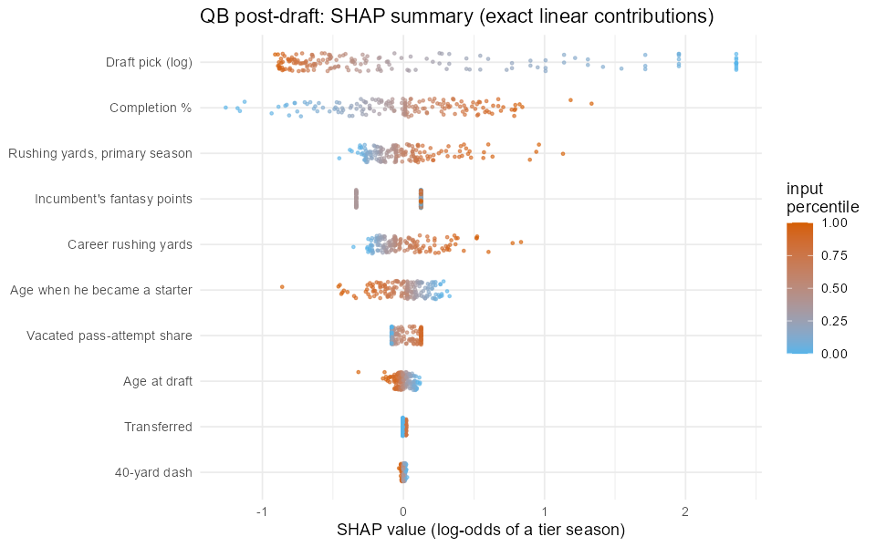

---

## Running backs

**In one line:** an early pick who catches passes, landing where touches are open.

| Rank | Input | AUC drop | Odds per SD (any tier) |
|---|---|---|---|
| 1 | Draft pick (log) | 0.273 | x0.34 |
| 2 | Receptions, primary season | 0.016 | x1.26 |
| 3 | Vacated touch share | 0.007 | x1.08 |
| 4 | Speed score | 0.002 | x1.07 (missing flag x0.94) |
| 5 | 40-yard dash | 0.002 | missing flag only, x0.97 |
| 6 | No 40 time | 0.002 | x0.97 |
| 7 | Career yards per carry | 0.001 | x1.06 |
| 8 | Broad jump | 0.000 | x1.02 |

- **RB has the steepest pick curve of the four.** P(RB24) is 88% at pick 10, 61% at pick
  32, 26% at pick 100 and 13% at pick 200.
- **Receiving is still the production signal:** primary-season catches from 4 to 43 move
  P(RB24) from 21% to 34% at the same pick, as in the pre-draft model.
- **Landing spot matters a little:** a team losing most of its prior-year touches (0% to
  88% vacated) moves P(RB24) from 25% to 29%.
- **Speed shows up mostly as "did he test".** Speed score is a small plus (x1.07), but the
  missing flags for speed score and the forty (backs who skipped the drills)
  carry about as much weight. Treat that part as a combine-attendance artifact.
- **Power 5, share of team scrimmage yards and short final season** all drop to zero. The
  pick already reflects them.

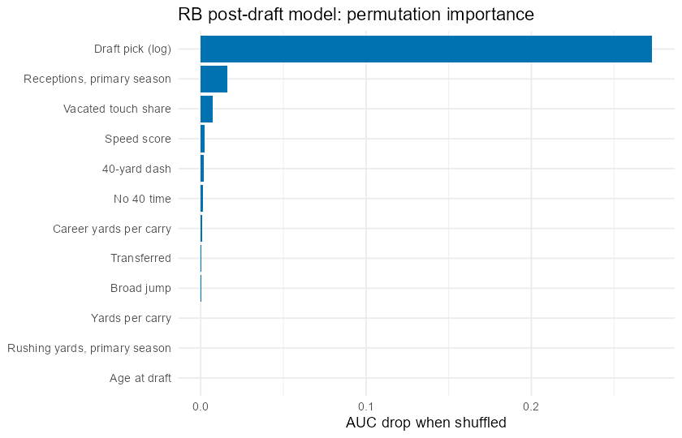
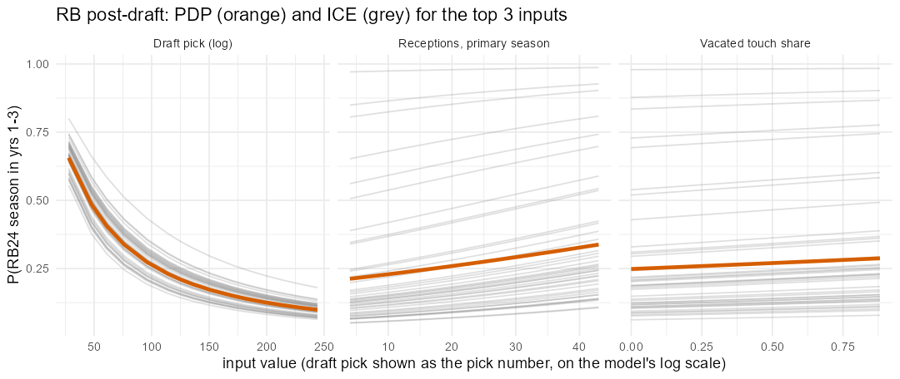
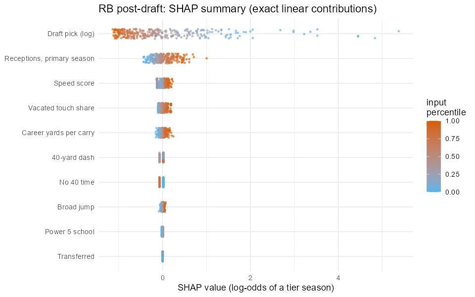

---

## Tight ends

**In one line:** an early pick with a strong recruiting pedigree, a lighter, more athletic
frame, and an open target share, who didn't transfer.

| Rank | Input | AUC drop | Odds per SD (any tier) |
|---|---|---|---|
| 1 | Draft pick (log) | 0.181 | x0.40 |
| 2 | Transferred | 0.017 | x0.83 (see note) |
| 3 | Recruiting rating | 0.012 | x1.16 |
| 4 | Weight | 0.009 | x0.89 (missing flag x0.88) |
| 5 | Vacated target share | 0.005 | x1.15 |
| 6 | Broad jump | 0.004 | missing flag only, x1.08 (see note) |
| 7 | Vertical jump | 0.004 | x1.13 |
| 8 | Height | 0.002 | missing flag only, x0.88 |
| 9 | Ever broke out | 0.002 | x1.13 |
| 10 | Featured seasons | 0.001 | x1.05 |

- **Recruiting pedigree survives the draft.** It is the one college input the TE model keeps
  from its pre-draft version: a rating from 0.77 to 0.98 moves P(TE24) from 21% to 32% at
  the same pick.
- **"Transferred" ranks 2nd on a tiny sample.** Only 10 of 202 drafted TEs transferred, and
  none of them hit. The PDP (27% vs 16%) is real in the data, but 10 players is too few to
  trust. Treat it as a small-sample artifact.
- **Combine missing flags carry real weight here.** Missing height and weight (x0.88, set
  for 27 TEs who weren't measured, none of whom hit) is a "wasn't invited or didn't test"
  signal. A missing broad jump is a small plus (x1.08), which reflects which TEs chose to
  skip that drill. Both say more about combine attendance than about the players.
- **Lighter and bouncier is better at the same pick:** x0.89 per SD of weight and x1.13 per
  SD of vertical. Receiving TEs score fantasy points; blocking TEs get drafted for other
  reasons.
- **Open targets help:** x1.15 per SD of vacated target share, the biggest landing-spot
  effect of the four positions.
- The TE model has the smallest sample (22 top-8 hits), so these effects are the least
  certain of the four.

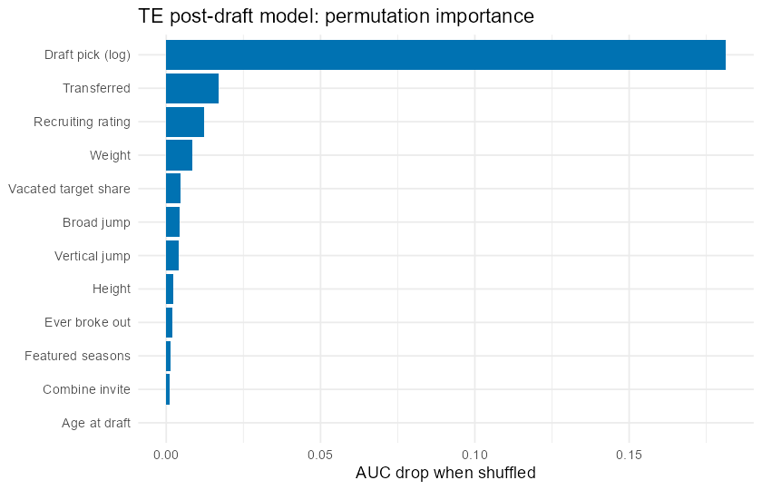
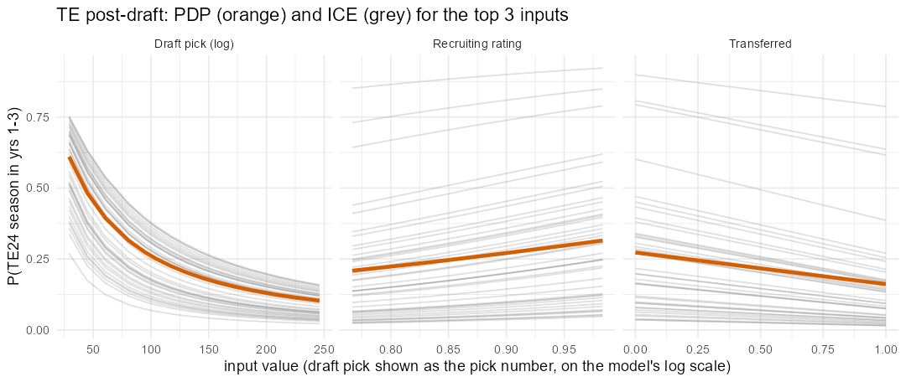
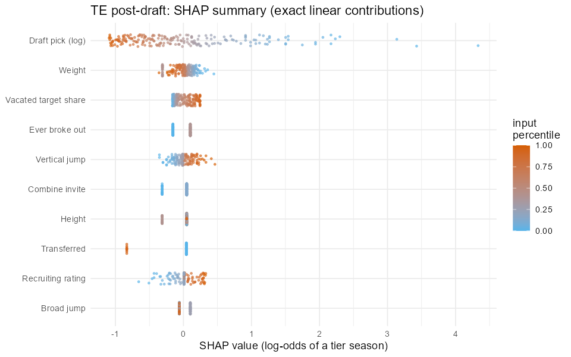

---

## Across positions

- **Draft capital is the model.** One SD earlier in log pick multiplies the odds of a tier
  season by about 2.3 to 2.9 at every position, and no college input comes close.
- **Each position keeps one or two college signals:** completion % and rushing for QBs,
  receptions for RBs, recruiting rating for TEs, and youth (breakout age, early declare)
  for WRs. These are the "beyond the pick" signals worth checking when two players go at a
  similar slot.
- **Landing spot is small:** vacated share helps TEs (x1.15) and RBs (x1.08), and is zeroed
  for WRs. It is close to zero for QBs (its permutation drop is slightly negative).
- **Missing-value flags explain several high ranks:** QB incumbent points (a join gap), TE
  height, weight and broad jump, and RB forty and speed score (combine attendance). They are
  real patterns in the training data, but they describe how the data were collected, not
  the players.
- **Athleticism is mostly priced in:** given the pick, the WR athletic component is slightly
  negative, and for RBs and TEs only a few drills survive with small effects.

Numbers come from `pd_post_<pos>_importance.csv`, `pd_post_<pos>_coefs.csv`,
`pd_post_<pos>_pdp_ice.csv`, `pd_post_predictors_summary.csv` and `phase8_log.txt`;
`pd_08_post_predictors.R` rebuilds them (about 1.5 minutes).
