# What drives the pre-draft model, by position

This page explains which college inputs matter most in each position's pre-draft
(college-only) model, and by how much. Back to the [Pre-Draft Model README](README.md).

**How to read it**

- **Target:** a season in NFL years 1-3 at the top tier, the top two tiers, or any tier
  (QB/RB/TE 8/16/24, WR 12/24/36). The effects below are for the any-tier model unless a
  tier is named.
- **Permutation importance:** how much the model's AUC on the training pool drops when one input is
  shuffled (its missing-value flag is shuffled with it). A bigger drop means the model
  leans on it more.
- **Odds per SD:** how much the odds of a hit change when the input rises by one standard
  deviation of the 2010-2023 training pool, holding the rest fixed. 2.0 means double the
  odds; 0.5 means half.
- **Partial dependence (PDP):** the average P(any tier) as the input moves from its 5th to
  its 95th percentile, holding everything else at each player's own values. The grey ICE
  lines in the plots run parallel to the average because the chosen models are additive in
  log-odds, so there are no strong interactions to read.
- **SHAP:** each input's contribution to one player's log-odds. These drive the "pushing
  up / pulling down" columns in the player deep dives (`pd_player_deep_dive.csv`). The
  SHAP ranking (mean |value|) agrees with the importance ranking at every position.
- **Training pool:** every draft-eligible college player, 2010-2023 classes, not just
  drafted ones. A player who never reached the NFL counts as a miss. "Primary season" is
  the last college season with real volume (QB 100+ attempts, RB 50+ touches, WR/TE 15+
  catches), so an injury-shortened final year doesn't define a player.

| Position | Chosen model | Training pool | Hits (top / top two / any tier) |
|---|---|---|---|
| WR | Logistic regression, 5 inputs | 2,785 | 39 / 68 / 95 |
| QB | Elastic net, 23 inputs | 882 | 20 / 31 / 44 |
| RB | Elastic net, 24 inputs | 1,618 | 36 / 58 / 81 |
| TE | Elastic net, 20 inputs | 997 | 21 / 43 / 59 |

---

## Wide receivers

**In one line:** a big-volume, young, Power 5 receiver who was a highly rated recruit.

The WR model is a 5-input logistic regression. It beat the elastic net, random forest
and XGBoost on rolling validation (the elastic net was a statistical tie, so the simpler
model wins). The other 16 college inputs add nothing once these five are in: shuffling
any of them moves AUC by 0.000.

| Rank | Input | AUC drop | Effect on the odds (any tier) | z |
|---|---|---|---|---|
| 1 | Receiving yards, primary season | 0.120 | x1.4 per extra 100 yards (x2.7 per SD) | 6.8 |
| 2 | Years out of high school | 0.027 | x0.46 per extra year | -5.1 |
| 3 | Power 5 school | 0.020 | x2.8 | 3.4 |
| 4 | Dominator rating (share of team receiving yards and TDs) | 0.008 | x1.35 per SD | 1.8 |
| 5 | Recruiting rating | 0.007 | x1.8 per SD | 3.6 |

- **Receiving yards** are by far the biggest driver. Going from 153 to 1,120 yards moves
  P(WR36) from 0.5% to 8.6%.
- **Age** is the second-biggest effect. Each extra year out of high school roughly halves
  the odds, so a 1,000-yard true junior is worth far more than a 1,000-yard 6th-year
  senior.
- **Recruiting** matters more at the top than its AUC drop suggests. It is significant in
  all three tier models (z = 3.0 to 3.6).
- **Dominator** is only borderline once yards are in (p = 0.07). The two overlap: a
  receiver with big yardage usually has a big team share.

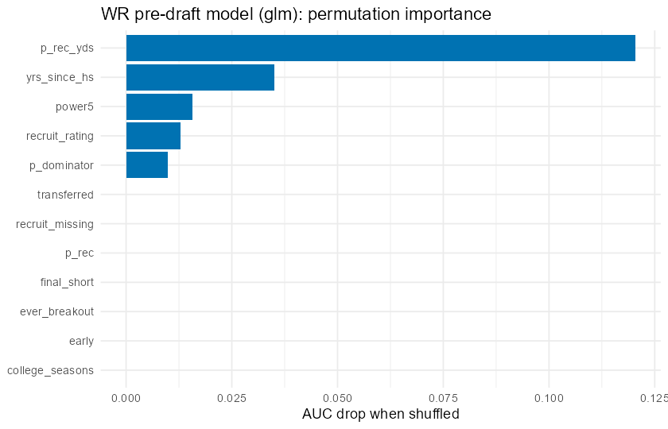
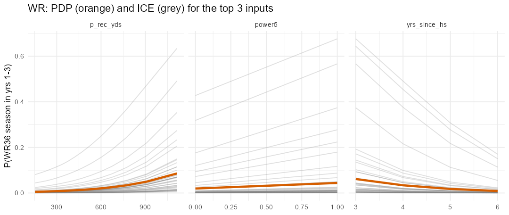
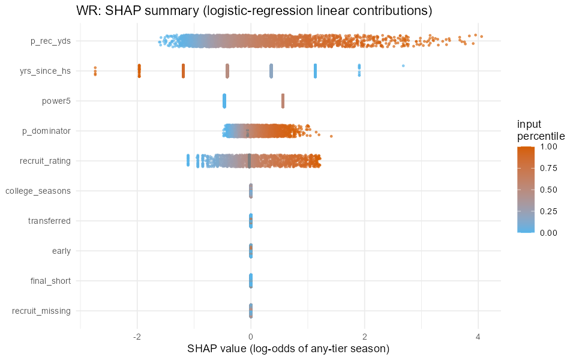

---

## Quarterbacks

**In one line:** an efficient passer (high adjusted yards per attempt and completion
rate) who carried his offense young and could also run.

| Rank | Input | AUC drop | Odds per SD (any tier) |
|---|---|---|---|
| 1 | Best-season adjusted yards per attempt (AY/A) | 0.034 | x2.7 |
| 2 | Completion %, primary season | 0.023 | x2.3 |
| 3 | Share of team pass attempts | 0.019 | x1.5 |
| 4 | Years out of high school | 0.009 | x0.58 |
| 5 | Career rushing yards | 0.008 | x1.5 |
| 6 | Yards per attempt, primary season | 0.005 | x0.71 (see note) |
| 7 | Power 5 school | 0.004 | x1.5 |
| 8 | College seasons | 0.004 | x0.72 |
| 9 | INT rate | 0.004 | small |
| 10 | Pass attempts, primary season | 0.003 | x1.4 |

- **Efficiency comes first.** AY/A from 4.6 to 10.7 moves P(QB24) from 0.7% to 9.2%, and
  completion % from 49% to 70% moves it from 1.1% to 8.0%.
- **Age matters most for the top tier.** For a QB8 season, years out of high school is the
  single biggest effect (x0.46 per SD), so young, efficient starters are the profile of a
  fantasy QB1.
- **Rushing is a plus:** each SD of career rush yards is worth about x1.5.
- **Yards per attempt is negative** only because AY/A is already in the model. Given the
  same AY/A, more of it coming from raw yards, rather than TDs and avoiding INTs, is a
  slightly worse sign. Read the two together, not Y/A on its own.
- **Recruiting rating** is a moderate plus (x1.5 per SD for any tier).

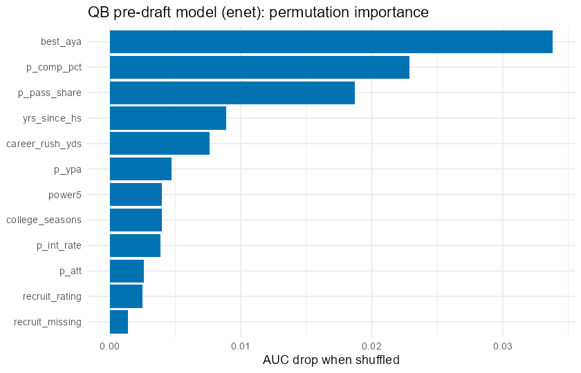
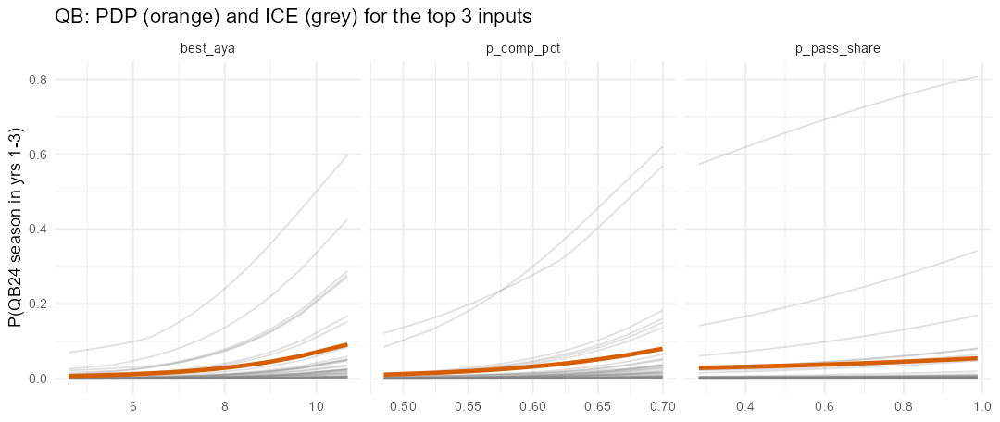
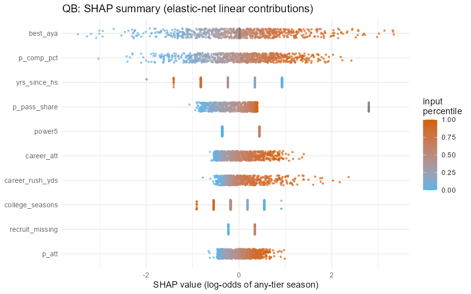

---

## Running backs

**In one line:** a Power 5 back who catches passes, scores, and didn't have his final
season cut short.

| Rank | Input | AUC drop | Odds per SD (any tier) |
|---|---|---|---|
| 1 | Power 5 school | 0.030 | x2.2 (Power 5 vs not) |
| 2 | Best-season share of team scrimmage yards | 0.022 | see note |
| 3 | Receiving yards, primary season | 0.017 | x1.65 |
| 4 | Short final season (injury or lost job) | 0.012 | x0.61 |
| 5 | Rushing TDs, primary season | 0.011 | x1.5 |
| 6 | Years out of high school | 0.008 | x0.62 |
| 7 | Yards per carry | 0.004 | x1.4 |
| 8 | Career rushing yards | 0.003 | x1.3 |
| 9 | Rushing yards, primary season | 0.002 | x1.3 |
| 10 | Share of team TDs | 0.002 | x1.2 (x1.5 for RB8) |

- **School level matters most for RBs.** Power 5 roughly triples P(RB24), from 2.4% to
  7.5%. In the credibility test (`pd_05_conference_test.R`), individual conferences add
  nothing beyond this flag.
- **Receiving is the production signal.** Primary-season receiving yards from 3 to 327
  move P(RB24) from 2.6% to 8.1%. Pass-catching backs have the clearest path to fantasy
  value.
- **A short final season is a red flag** (x0.61). Backs whose last year fell below 50
  touches after a bigger earlier year hit less often.
- **Best scrimmage share** ranks high on importance but has a flat PDP. Its importance
  comes through its missing-value flag: backs with missing team totals are mostly data
  gaps (cfbd lacks some FBS backs entirely), and those players were disproportionately
  drafted. Treat it as a data-coverage artifact, not a real football signal.
- **Top tier (RB8)** leans more on receiving yards, career rushing yards and share of team
  TDs (x1.5 to x1.6 per SD each).

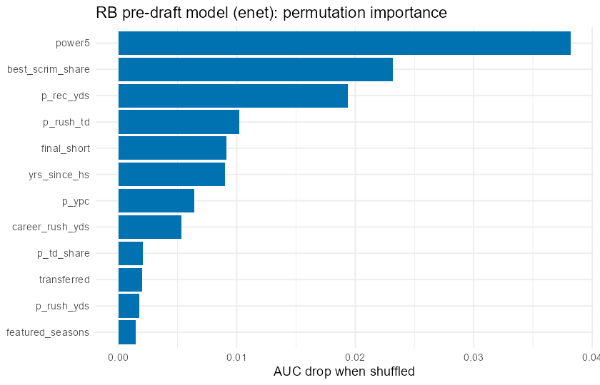
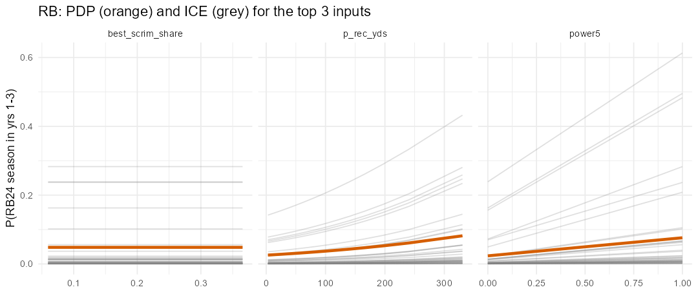
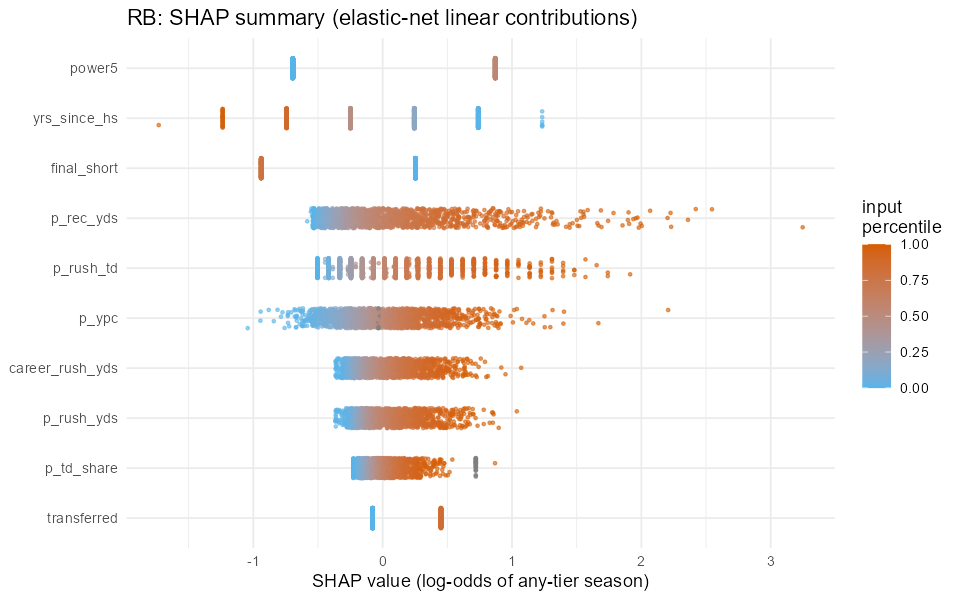

---

## Tight ends

**In one line:** a highly recruited, young TE who was a real part of the passing game
(yards per team pass attempt) over several seasons.

| Rank | Input | AUC drop | Odds per SD (any tier) |
|---|---|---|---|
| 1 | Recruiting rating | 0.026 | x1.4 |
| 2 | Years out of high school | 0.023 | x0.73 |
| 3 | Receiving yards per team pass attempt, primary season | 0.012 | x1.5 |
| 4 | College seasons | 0.011 | x0.83 |
| 5 | Career receiving yards | 0.008 | x1.2 (x1.6-1.7 for TE8 / TE16) |
| 6 | Share of team catches | 0.005 | x1.2 (top tiers) |
| 7 | Short final season | 0.003 | x0.88 |
| 8 | Power 5 school | 0.003 | x1.2 |
| 9 | Yards per catch | 0.002 | small |
| 10 | Transferred | 0.002 | x0.87 |

- **TE is the one position where pedigree beats production.** Recruiting rating from 0.74
  to 0.96 moves P(TE24) from 3.1% to 11.1%. Tight ends develop late, and the recruiting
  services' read on size and athleticism carries information the box score doesn't.
- **Youth matters:** 3 to 6 years out of high school cuts P(TE24) from 8.0% to 3.8%.
- **Yards per team pass attempt** is the best production measure. It captures how much of
  the passing game ran through him, independent of how much his team threw. Going from
  0.19 to 1.73 moves P(TE24) from 3.1% to 9.2%.
- **For the top tiers (TE8, TE16),** career receiving yards take over as the biggest
  effect (x1.6 to x1.7 per SD).
- The TE model has the smallest sample (21 top-8 hits), so these effects are the least
  certain of the four positions.

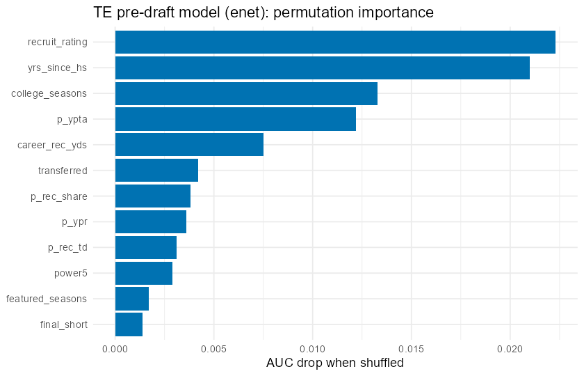
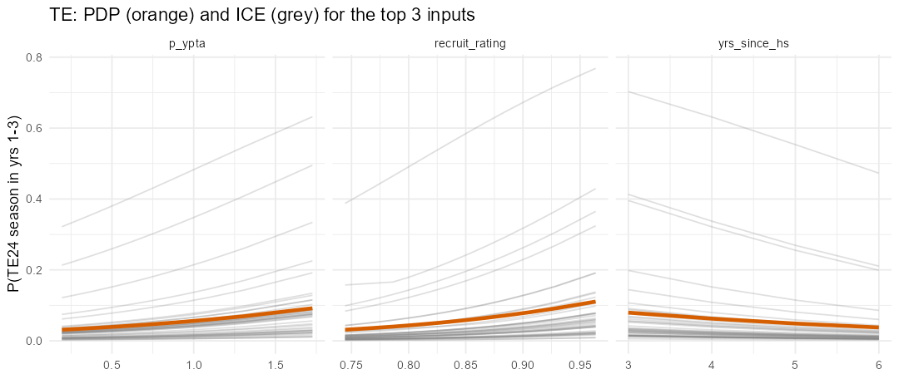
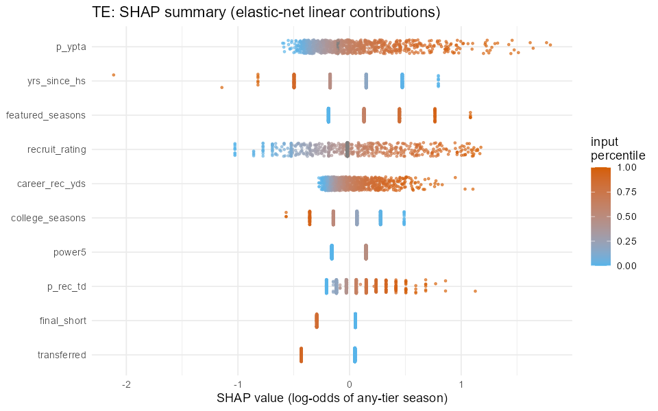

---

## Across positions

- **Age (years out of high school) matters at every position,** with roughly x0.5-0.75
  odds per SD. Early production predicts NFL success better than the same production a
  year or two later.
- **Power 5 matters most for RBs and WRs** (about x2-3) and least for TEs (x1.2). FCS
  production from 2022 on is translated to an FBS scale before scoring (factors 0.685 for
  receiving and rushing, 0.789 for passing; see the README).
- **Recruiting rating matters most for TEs,** then WRs, and is a moderate plus for QBs and
  RBs.
- **None of these models see size, speed or film.** That is by design (no combine), and it
  is why they work better as a "whose production profile looks like past hits" screen than
  as a draft board.

Numbers come from `pd_<pos>_importance.csv`, `pd_<pos>_pdp_ice.csv`, the fitted models in
`pd_<pos>_models.rds` and `phase3_run_log.txt`; `pd_03_interpret.R` rebuilds them.
