# Rookie Pick Strategy

This research asks which dynasty rookie picks pay off, whether to trade back from the 1.01, what to spend picks on, how the 2027 class fits the historical pattern, and what all of that means for Kyle's two leagues.

**Status: research only.** Nothing here changes the site, the models or the weekly refresh. Interactive report with every chart: https://claude.ai/artifact/WKN1QzTfvdzKTgKzg6rR6T (built 2026-11-21).

---

## Contents

1. [The answer in one page](#1-the-answer-in-one-page)
2. [Data and method](#2-data-and-method)
3. [Which pick slots pay off](#3-which-pick-slots-pay-off)
4. [Trading the 1.01 (and 1.02 / 1.03) back](#4-trading-the-101-and-102--103-back)
5. [Position at the same price](#5-position-at-the-same-price)
6. [What to spend picks on: rookies vs veterans](#6-what-to-spend-picks-on-rookies-vs-veterans)
7. [The 2027 class](#7-the-2027-class)
8. [League guidelines: League of Lampoons](#8-league-guidelines-league-of-lampoons)
9. [League guidelines: Dynasty Confederates](#9-league-guidelines-dynasty-confederates)
10. [Limits](#10-limits)
11. [Files and how to rerun](#11-files-and-how-to-rerun)

---

## 1. The answer in one page

| Question | Answer (reference league: 12 teams, superflex, full PPR) |
|---|---|
| Keep or trade the 1.01? | Keep it, unless the package includes a top-7 pick. All 14 1.01s had a starter-level season and 10 of 14 reached the top tier. Against two picks from 1.02–1.12, the 1.01 produced more 60% of the time (75% on trade value after year 3), and against two late firsts it won 86%. |
| Where is the drop-off? | After 1.06. 49% of picks 1.01–1.06 had a top-tier season, compared with 20% of picks 1.07–1.12 (Fisher p = 0.0002). |
| Best-priced firsts | 1.04–1.06, which produced 1.2x their price. |
| Worst-priced firsts | 1.02–1.03, at 0.70x, driven by early superflex QB busts. From 1.02 or 1.03, trading back for two firsts won about 2 times in 3. |
| Late 2nds and 3rds | They paid back about their price on average, but about 7 in 10 produced next to nothing. They work as lottery tickets. |
| Position at the same price | Not significant once you know the price (GLM). Round-1 TEs were the weak spot (0.47x). |
| Spend picks on | Under 10k, use rookie picks (1.24–1.34x vs 0.44–0.60x for veterans at the same price). At 20k+, buy veterans aged 25–27 (1.19x, 14% bust) over picks (0.88x, 28% bust). Never buy players 28+ (0.74x), especially RBs (0.21x). |
| Now vs later | Prime veterans deliver the most in years 1–2 per unit of price. Rookie picks deliver the most in years 3–5. |

**In plain language:** rookie picks are lottery tickets, and about 60% of all first-three-round value came from the best 10% of picks. The top 6 picks are different: about half become top players. After that it's closer to 1 in 5. Two average players don't beat one star.

---

## 2. Data and method

| Piece | Source |
|---|---|
| **Price at draft time** | `Trade_Values/dv_rookie_board_values.csv`, post board, `value_100k`. This is the draft-time pick value on the 100k scale, out-of-class for every class shown. |
| **Rookie draft slot** | Each class's drafted QB/RB/WR/TE ranked by that price. Slots 1–12 = 1.01–1.12, up to 3.12. Checked against NFL-draft order (same pattern, see `outputs/robust_nfl_order.csv`). |
| **Produced** | Fantasy points over replacement over the first 5 NFL seasons: per season, games × max(PPG − replacement line of the draft season, 0), discounted 0.93^k. This is the same definition as the live pick calibration in `dv_13` ("players' definition"). It was rebuilt in Python from nflverse season stats and matches the R version at r = 0.99 with a total ratio of 1.00. |
| **100k scaling** | Produced value is scaled so all 36 slots of 2010–2021 together produced exactly what they cost. A ratio above 1 means a better buy than the average pick, and below 1 a worse one. |
| **Second lens** | Dynasty value held at the end of season 3, from the point-in-time history (`prospect-actuary/data/history/values.json`, classes 2016–2023). |
| **Hits** | Best finish in the first 3 seasons (`PostDraft_Model/pd_post_player_grades.csv`). Top tier = QB8/RB8/WR12/TE6. Any tier = QB24/RB24/WR36/TE18. |
| **Veterans** | Dynasty value at the end of seasons 2016–2020 (week 17 snapshot), scored on the next 5 seasons with the same production definition. |
| **Samples** | Production 2010–2021 (12 per slot). Hits 2010–2023 (14 per slot). Year-3 value 2016–2023. Veterans 2017–2021 buys. |
| **Methods (ATPA/PA)** | Bootstrap over draft classes for every interval, quasi-Poisson GLM (production ~ log price + position / slot range), Fisher's exact test on the hit-rate cliff, robustness checks on slot definition and league settings. |

---

## 3. Which pick slots pay off

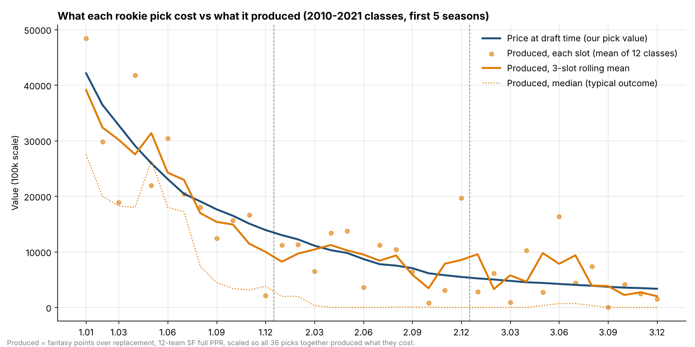

| Range | Avg price | Avg produced | Median produced | Produced / price (95% CI) | Yr-3 value / price (95% CI) | Top-tier hit | Any-tier hit | Bust (<10% of price) |
|---|---|---|---|---|---|---|---|---|
| 1.01 | 42.1k | 48.4k | 42.3k | **1.15** (0.73–1.61) | **1.42** (1.10–1.79) | 71% | 100% | 0% |
| 1.02–1.03 | 34.6k | 24.4k | 9.8k | **0.70** (0.34–1.18) | 0.75 (0.54–0.98) | 43% | 79% | 29% |
| 1.04–1.06 | 26.0k | 31.4k | 16.1k | **1.20** (0.89–1.57) | 0.93 (0.63–1.21) | 45% | 67% | 28% |
| 1.07–1.09 | 19.0k | 17.0k | 7.6k | 0.89 (0.50–1.35) | 0.87 (0.60–1.17) | 24% | 60% | 31% |
| 1.10–1.12 | 15.2k | 11.5k | 1.3k | 0.76 (0.31–1.30) | 1.00 (0.72–1.29) | 17% | 55% | 50% |
| 2.01–2.06 | 10.8k | 10.0k | 0 | 0.92 (0.47–1.47) | 0.86 (0.50–1.24) | 17% | 44% | 58% |
| 2.07–2.12 | 6.6k | 8.6k | 0 | 1.30 (0.71–1.96) | 1.57 (0.94–2.13) | 16% | 42% | 68% |
| 3.01–3.12 | 4.2k | 4.9k | 0 | 1.18 (0.76–1.66) | 0.94 (0.65–1.23) | 7% | 20% | 76% |

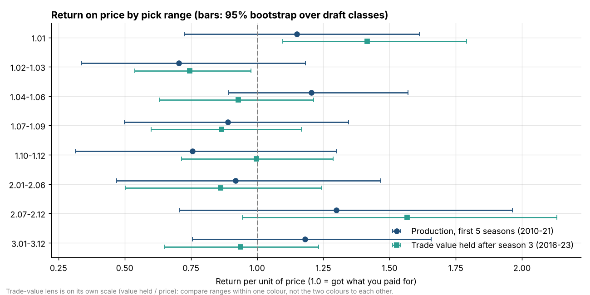
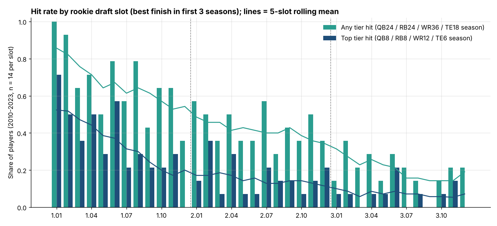
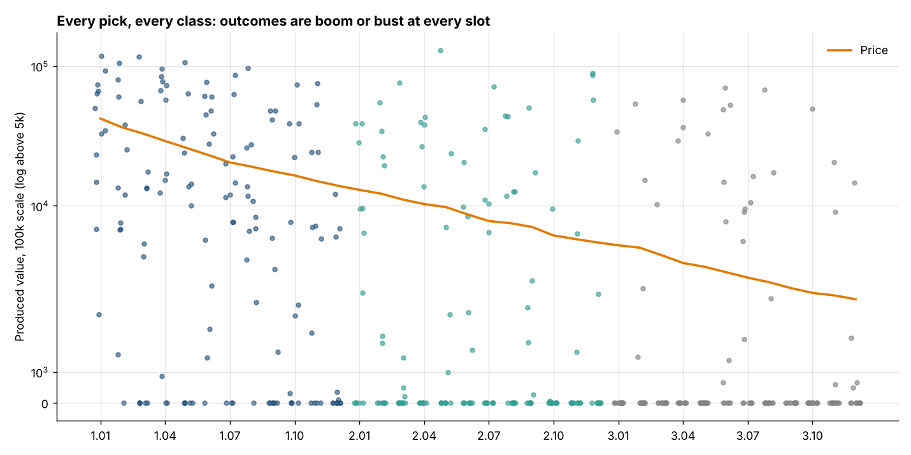

**Findings**
- **The cliff after 1.06:** top-tier hit rate is 49% for 1.01–1.06 vs 20% for 1.07–1.12 (p = 0.0002). After 1.07 the median pick produces close to nothing.
- **Value is concentrated:** the best 10% of the 432 picks made 59% of all value, and the best 25% made 91%.
- **GLM (`outputs/glm_results.txt`):** production rises with price at an elasticity of 0.86 (CI 0.64–1.08). No position term is significant beyond price. The 1.01 (+0.68) and 1.04–1.06 (+0.47) lean positive vs 1.07–1.09, but neither is significant alone. The hit-rate cliff is the stronger evidence.
- **Robustness:** ranking by NFL draft order instead of our value shrinks the 1.02–1.03 dip (0.85), but 1.04–1.06 stays above price (1.14) and the top-tier hit rate still drops after 1.06 (39% to 25%).

---

## 4. Trading the 1.01 (and 1.02 / 1.03) back

Every same-class pair of picks is compared with the kept pick, and the two players' values are added together (100k values are additive). Each cell shows how often keeping the pick won, by production / by trade value after year 3.

| Trade back for... | Keep 1.01 | Keep 1.02 | Keep 1.03 |
|---|---|---|---|
| Two random 1sts (1.02–1.12) | 60% / 75% | 37% / 35% | 25% / 25% |
| Early + mid 1st | 57% / 75% | 33% / 32% | 23% / 25% |
| Two mid 1sts (1.05–1.08) | 54% / 71% | 40% / 40% | 24% / 29% |
| Two late 1sts (1.09–1.12) | 86% / 88% | 60% / 46% | 46% / 33% |
| Late 1st + early 2nd | 83% / 92% | 63% / 57% | 41% / 45% |
| Two early 2nds | 80% / 93% | 67% / 63% | 37% / 59% |

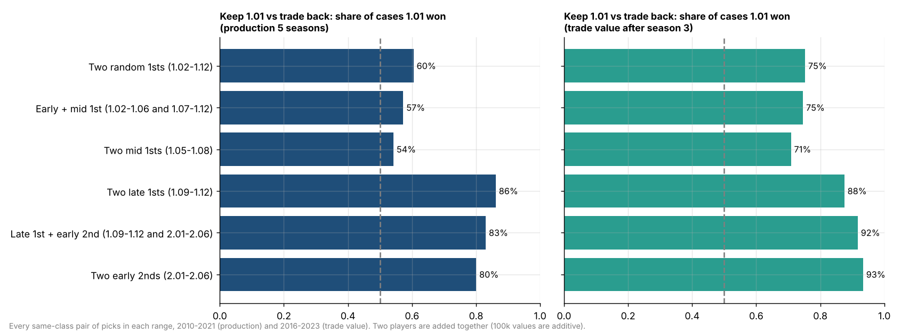
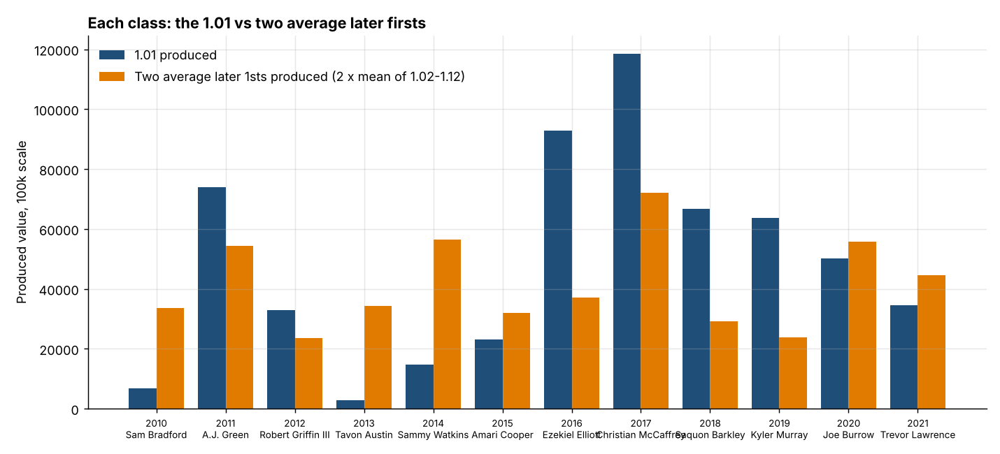

- On our prices, two random firsts cost 3.3k more than the 1.01 but produced 6.9k less.
- Against two *average* later firsts, the 1.01 wins only 6 of 12 classes. The average pair includes the rare hits (Mahomes at 1.08, Michael Thomas at 1.11), and you only land one of those less than half the time.
- **Rule:** keep the 1.01. Trade the 1.02 or 1.03 back if you get two firsts. Never trade the 1.01 for late firsts.

---

## 5. Position at the same price

| Round | Pos | n | Produced / price (95% CI) | Top-tier hit | Any-tier hit |
|---|---|---|---|---|---|
| 1 | QB | 36 | 0.96 (0.56–1.43) | 39% | 72% |
| 1 | RB | 42 | 1.08 (0.65–1.58) | 44% | 70% |
| 1 | WR | 60 | 0.88 (0.56–1.21) | 27% | 60% |
| 1 | TE | 6 | 0.47 (0.34–0.58) | 33% | 100% |
| 2 | QB | 13 | 2.78 (0.70–5.31) | 29% | 65% |
| 2 | RB | 42 | 0.96 (0.35–2.26) | 17% | 48% |
| 2 | WR | 75 | 0.86 (0.60–1.14) | 11% | 30% |
| 2 | TE | 14 | 1.03 (0.17–2.20) | 22% | 67% |
| 3 | WR | 73 | 1.30 (0.53–2.08) | 7% | 21% |

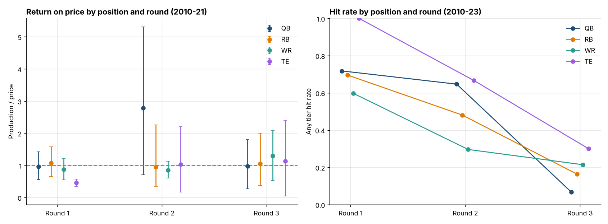
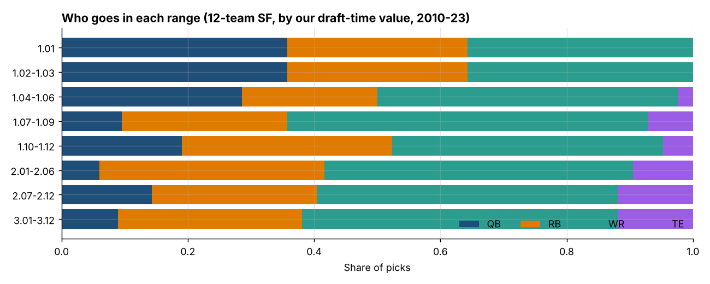

- **The 1.01 by position:** RB 1.01s (Elliott, McCaffrey, Barkley) averaged 93k produced, QB 1.01s 38k, and WR 1.01s 29k. Bijan Robinson (2023) fits the RB pattern. This is too few to be a rule.
- **2 FLEX** (site default) gives the same pattern. The 1.01's edge shrinks (1.15 to 1.01) because flex spots lower the edge of early QBs ([chart](charts/09_flex_sensitivity.png)).

---

## 6. What to spend picks on: rookies vs veterans

Same 100k price, same production definition. Veterans are priced at their offseason dynasty value (end of 2016–2020) and scored on the next 5 seasons.

| Buy | 2–5k | 5–10k | 10–20k | 20–35k | 35–60k |
|---|---|---|---|---|---|
| Rookie pick | **1.34** | **1.24** | 0.90 | 0.88 | 0.98 |
| Veteran 24 or younger | 0.54 | 1.52 | 0.73 | 1.02 | 0.86 |
| Veteran 25–27 | 0.44 | 0.79 | 0.85 | **1.19** | 0.90 |
| Veteran 28+ | 0.46 | 0.60 | 0.78 | 0.93 | 0.63 |

| Buy | QB | RB | WR | TE |
|---|---|---|---|---|
| Rookie pick | 1.13 | 1.05 | 0.92 | 0.85 |
| Veteran 24 or younger | **1.24** | 1.02 | 0.82 | 0.52 |
| Veteran 25–27 | 0.46 | 0.93 | **1.14** | 0.91 |
| Veteran 28+ | 0.80 | **0.21** | 0.71 | 0.82 |

| Buy | Now (years 1–2) / price | Later (years 3–5) / price |
|---|---|---|
| Rookie pick | 0.38 | **0.62** |
| Veteran 24 or younger | 0.47 | 0.46 |
| Veteran 25–27 | **0.55** | 0.39 |
| Veteran 28+ | 0.48 | 0.26 |

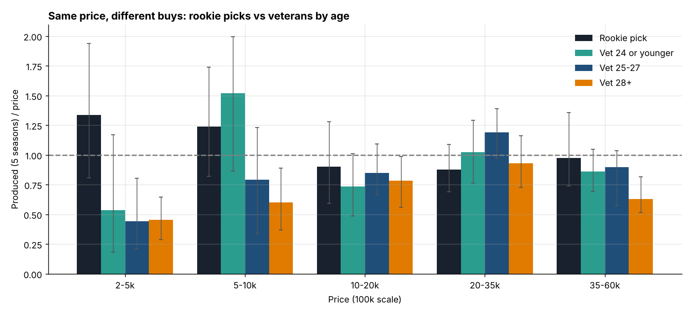
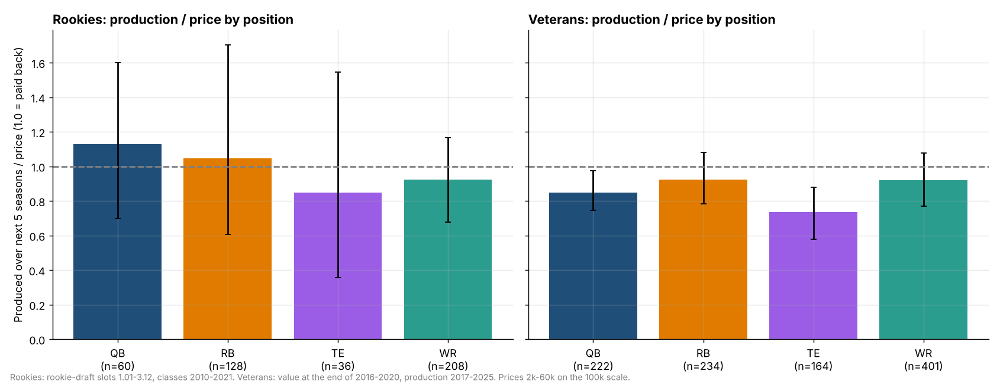
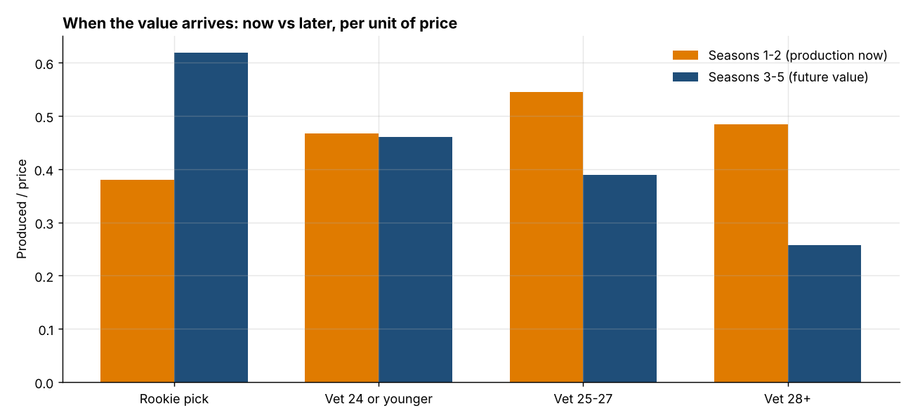

**Guidelines**
1. **Cheap end:** draft with 2nds and 3rds rather than buying cheap veterans.
2. **Expensive end:** a 25–27-year-old WR or a 24-or-younger QB at the price of a 1.02–1.07 has been the steadier buy, with similar return and about half the bust rate.
3. **Never spend picks on players 28+,** and above all not on RBs 28+.
4. **Contending:** buy prime veterans. **Rebuilding:** hold picks and young veterans.

**Scaling caveat:** with production scaled so rookie picks pay back 1.0, veterans paid back 0.83 overall. The within-group patterns are solid. The two headline cross-group results (cheap picks beat cheap veterans, and prime veterans beat picks at 20k+) still hold if veterans are shifted up 20%.

---

## 7. The 2027 class

Prices come from `dv_rookie_board_values.csv`, pre board, class 2027. Prospects in Kyle's mocks are priced at their median mock pick with the post-draft model, and the rest at pre-draft odds × P(declare). These are pre-NFL-draft prices and will move.

| Range | 2027 players | 2027 price | Hist price | 2027 top-tier odds | Hist model odds | Hist actual top tier |
|---|---|---|---|---|---|---|
| 1.01 | Jeremiah Smith (WR) | 49.4k | 42.0k | 89% | 79% | 71% |
| 1.02–1.03 | Becker, Coleman (WR) | 32.7k | 34.9k | 50% | 61% | 43% |
| 1.04–1.06 | Carr, Mestemaker (QB), Marsh (WR) | 27.9k | 26.3k | 38% | 43% | 45% |
| 1.07–1.09 | Mensah (QB), Duff, Williams (WR) | 18.9k | 19.2k | 25% | 33% | 24% |
| 1.10–1.12 | Baugh, Lacy (RB), J. Harris (WR) | 13.9k | 14.9k | 21% | 25% | 17% |
| 2.01–2.06 | Parker, Riley (RB), Chambliss, Moore (QB), J. Johnson (TE), R. Harris (WR) | 10.2k | 10.6k | 17% | 17% | 17% |
| 2.07–2.12 | Reynolds, Green (TE), Matthews, Wingo, Craver (WR), Dampier (QB) | 8.4k | 6.6k | 16% | 10% | 16% |
| 3.01–3.12 | 5 QB, 4 WR, 3 RB | 6.7k | 4.2k | 8% | 6% | 7% |

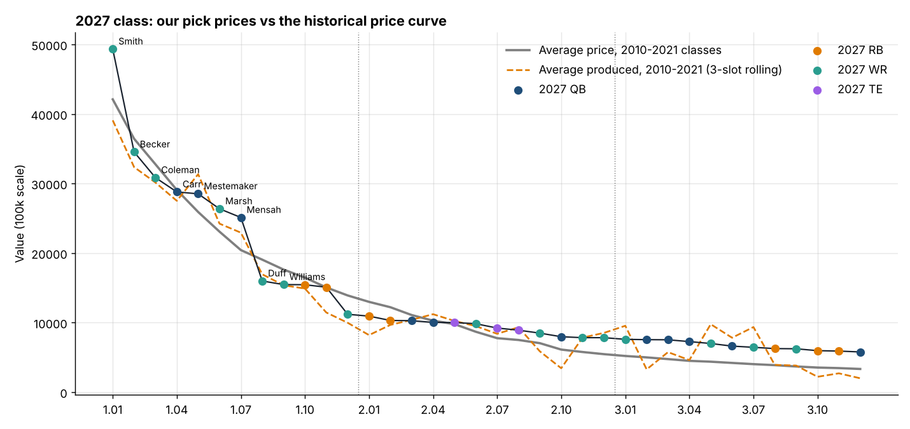
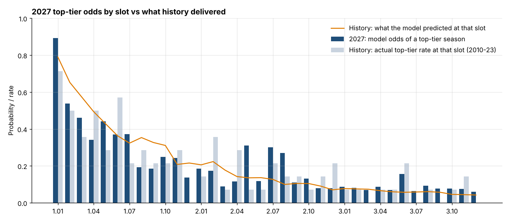

**Does 2027 look like past classes? Mostly yes.**
- **The 1.01 is the strongest on record:** Smith is 17% above an average 1.01, with 89% top-tier odds. Keep it. Two random 2027 firsts add up to about 45k, and a random pair loses to the 1.01 about 60% of the time even at equal prices.
- **The top group is 7 deep:** 1.02–1.07 all sit at 25–35k, then the price drops to 16k at 1.08. The model expects 3.0 top-tier players in 1.01–1.06 and 1.4 in 1.07–1.12 (historically 2.9 and 1.2 per class).
- **1.02–1.03 are WRs, not QBs,** so the historical QB-bust risk in that range moves to 1.04–1.07 (Carr, Mestemaker, Mensah). The model was historically too optimistic about 1.02–1.03 (61% predicted vs 43% actual).
- **Late picks are expensive:** late 2nds are priced 27% above history and 3rds 61% above. Sell them at these prices, or use them to draft.
- **2027 TEs at 2.05–2.08** carry about 30% top-tier odds, vs ~10% usual at that slot.
- **Class total:** 489k for the top 36 vs a 446k historical average.

---

## 8. League guidelines: League of Lampoons

**Settings:** 10 teams · 1 QB, 2 RB, 3 WR, 1 TE, 2 FLEX, superflex · half PPR · 6-pt pass TD. Sleeper also has TE +0.25 and some yardage bonuses that our values don't model.

**How these numbers were made:** every season since 2010 was rescored with these settings and the replacement lines rebuilt (2016–25 average replacement PPG: QB 18.1, RB 9.6, WR 9.6, TE 8.7). Price stays the generic value, so a ratio above 1 means *underpriced in this league* when leaguemates trade off generic charts.

| Lampoons | Result |
|---|---|
| Best-priced firsts | 1.04–1.06 (1.14x). 1.02–1.03 still the worst (0.71x). |
| 1.01 vs two random 1sts | 1.01 wins 57% |
| 1.01 vs two mid 1sts (1.05–1.08) | **1.01 wins only 46%**: the trade-down is about even |
| 1.01 vs two late 1sts | 1.01 wins 82% |
| Rookies by position | **RB 1.27** · QB 1.02 · WR 0.85 · **TE 0.61** |
| Round 1 by position | RB 1.29 (CI 0.88–1.80) · QB 0.89 · WR 0.80 · TE 0.25 |
| Veterans by position | RB ≤24: 1.32 · RB 25–27: 1.23 · QB ≤24: 1.19 · WR 25–27: 0.99 · TE ≤24: 0.32 · RB 28+: 0.34 |
| Picks vs veterans | Cheap picks 1.22–1.30x vs cheap veterans 0.44–0.65x. Veterans 25–27 at 20–35k: 1.10 vs picks 0.90. |

**Guidelines**
1. **RBs are the buy.** Half PPR and the 10-team format push value toward RBs. Use picks on RBs, and when trading picks for veterans, buy RBs 27 or younger.
2. **Fade TEs.** They were the worst buy in this league at every stage. Start a cheap one.
3. **WRs are slightly overpriced by generic charts.** Fix WR with 2nds plus depth, not with firsts.
4. **The 1.01 can be traded** for two picks inside 1.04–1.08. Never trade it for late firsts.
5. **Young QBs (24 and under) are good buys**, but QBs bought at 25–27 returned only 0.42x. Don't pay extra for a QB in that age range.
6. **2027 targets:** RBs Jadan Baugh and Kewan Lacy (about 1.10–1.11), then Wayshawn Parker and Dylan Riley (early 2nd).
7. **Sell players 28+ (especially RBs) to contenders before the offseason.**

**Applied (2026-11-21):** Kyle is rebuilding (about 6% playoff odds). Traded Josh Allen + DJ Moore for C.J. Stroud + a 2027 1st + Fernando Mendoza (about +4–10k on Lampoons values, and much younger). Next: sell Jonathan Taylor (28.6k, turns 28) to a contender for a 1st plus a young RB or WR, then other veterans 28+. Hold the young core and three 2027 1sts, and draft RBs. If possible, combine two late 1sts into one top-6 pick.

---

## 9. League guidelines: Dynasty Confederates

**Settings:** 12 teams · 1 QB, 2 RB, 3 WR, 1 TE, 2 FLEX, superflex · half PPR · TE premium +0.5 (TEs get 1.0 per catch) · 6-pt pass TD · first-down bonus RB +0.25, WR +0.5, TE +1. Average replacement PPG for 2016–25: QB 17.0, RB 10.2, WR 10.2, TE 10.2.

| Confederates | Result |
|---|---|
| Best-priced firsts | 1.04–1.06 (1.09x). 1.02–1.03 worst (0.67x). |
| 1.01 vs two random 1sts | 1.01 wins 53% |
| 1.01 vs two mid 1sts (1.05–1.08) | **1.01 wins only 44%**: trading down to two top-8 picks is slightly favorable |
| 1.01 vs two late 1sts | 1.01 wins 81% |
| Rookies by position | **TE 1.64** · RB 1.07 · QB 0.99 · WR 0.88 |
| Rookie TEs by round | Rd 1 1.04 · **Rd 2 1.91** · Rd 3 2.10 (small samples) |
| Veterans by position | **TE 25–27: 1.34** · TE 28+: 1.17 · RB ≤24: 1.13 · QB ≤24: 1.08 · WR 25–27: 1.03 · RB 28+: 0.30 |
| Picks vs veterans | Cheap picks 1.32–1.43x vs cheap veterans 0.60–0.74x. Veterans 25–27 at 20–35k: 1.18 vs picks 0.87. |

**Guidelines**
1. **TEs are the buy.** The TE premium and +1 per TE first down make TEs the most underpriced position against generic values, both as rookies (especially round 2) and as veterans. TEs also age better here (28+ still 1.17x).
2. **WRs are the weakest buy** at generic prices, even with the +0.5 first-down bonus.
3. **The 1.01 is about even** against two mid firsts, so take a trade-down only if both picks land in the top 8.
4. **RBs and QBs are about fair.** Prefer RBs and QBs 24 and under, and never RBs 28+.
5. **2027 targets:** TEs Jamari Johnson, Luke Reynolds and Trey'Dez Green (about 2.05–2.08 on generic prices), the best-returning spot in the study for this league.
6. **Cheap picks still beat cheap veterans, and prime veterans still beat picks at 20k+,** same as everywhere.

---

## 10. Limits

- There are only 12–14 players per slot, so single slots are noisy. Trust the ranges and the hit-rate cliff.
- We have no historical market prices or rookie ADP. "Price" is our own draft-time value, and the slot order is our ranking (with an NFL-order check).
- Production stops at 5 seasons. The year-3 value lens partly covers long careers.
- Adding two players' values assumes both start. On deep benches the second player may not, which makes trade-downs look slightly better than they are.
- League results use generic prices with league-rescored production. Position-by-round cells hold 6–75 players and have wide intervals.
- 2027 prices are pre-NFL-draft and will move after the draft.

---

## 11. Files and how to rerun

| File | What it does |
|---|---|
| `rp_01_build.py` | Downloads/reads nflverse season stats, builds replacement lines, joins the draft board, computes realized production (v = 0.93) |
| `rp_02_analysis.py` | Rookie-draft slots, hits, year-1/2/3 dynasty value from the history archive → `outputs/players.csv` |
| `rp_03_slots.py` | Slot tables, trade-down tests, position splits, GLM, flex and NFL-order checks, charts 01–09 |
| `rp_04_tables.py` | HTML tables for the report |
| `rp_05_2027.py` | 2027 class vs history, charts 10–11 |
| `rp_06_spend.py` | Rookie picks vs veterans by age/position/price, charts 12–14 |
| `rp_07_leagues.py` | Rescores everything for the reference, site default, League of Lampoons and Dynasty Confederates settings, charts 15–19 |
| `outputs/` | Every table: `slot_groups.csv`, `per_slot.csv`, `trade_down.csv`, `per_class_101.csv`, `by_position.csv`, `glm_results.txt`, `robust_nfl_order.csv`, `class_2027_*.csv`, `spend_*.csv`, `league_cmp_*.csv` |

Scripts are Python (pandas, numpy, scipy, statsmodels, matplotlib, pyreadr). They were run in the cloud with nflverse stats saved to a scratch `dl/` folder (`stats_player_reg_<year>.csv`, `draft_picks.csv`, `players.csv` from nflverse-data releases), and read `Trade_Values/dv_rookie_board_values.csv`, `PostDraft_Model/pd_post_player_grades.csv` and the site's `data/history/` files. Paths at the top of each script point at the research folder; change `OUT`/`HIST` to rerun elsewhere.

Data credits: nflverse (CC BY 4.0) and the Prospect Actuary models and value history.
