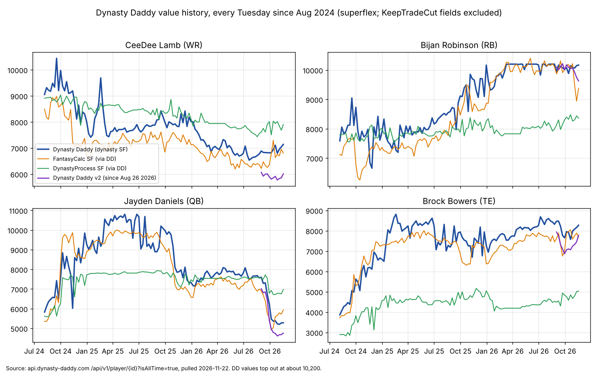

# Dynasty Daddy historical values (research, 2026-11-22)

Kyle asked: does Dynasty Daddy have time-stamped historical values? **Yes, but only through undocumented endpoints, and
its own values only go back to 2024-08-01.** Research only; nothing is pulled by the refresh or shown on the site.

## What exists

| Endpoint | Documented? | What it returns |
|---|---|---|
| `GET api.dynasty-daddy.com/api/v1/values/dynasty` and `/redraft` | Yes ([API docs](https://dynasty-daddy.com/help/api-documentation)) | Current values only. No date field. What `dv_14` already uses. |
| `GET /api/v1/player/{name_id}?isAllTime=true` | No (used by DD's own player pages) | One row per day for one player, with a `date` timestamp (about 08:00 UTC). CeeDee Lamb: 2,047 daily rows, 2021-04-16 to today, one per day. Without `isAllTime` it returns a shorter recent window. |
| `GET /api/v1/player/all/prev/{days}` | No (used by DD's "change since" views) | Whole board as of N days ago, top 500 players, same fields. `prev/480` returned 2025-07-30 (321 with DD values); `prev/1300` returned 2023-05-02 with no DD values. |

Each daily row holds many markets side by side, in both 1QB and superflex (`sf_`) versions:

| Field prefix | Market (from DD's own code) | First date with values (Lamb) |
|---|---|---|
| `daddy_` / `daddy_rd_` | **Dynasty Daddy dynasty / redraft (v1)**. This is what the public `/values` API serves today (Lamb SF 6866 matched exactly). | 2024-08-01 |
| `daddy_v2_` | Dynasty Daddy v2 (newer model, not in the public API) | 2026-08-26 |
| `fc_` | FantasyCalc | 2023-05-21 |
| `dp_` | DynastyProcess | 2023-05-21 |
| `adp_`, `ds_`, `pfn_`, `ra_`, `rt_`, `fp_`, `dss_`, `madden_` | ADP Daddy, Fantasy Navigator, PFN, Roster Audit, RotoTrade, FantasyPros, DraftSharks, Madden | 2024-2026 |
| unprefixed `trade_value` / `sf_trade_value`, and `ktc_rd_` | **KeepTradeCut** (DD's code maps the default market to these fields) | 2021-04-25 |

So the long 2021+ history is KeepTradeCut, which we never use. Dynasty Daddy's own values give about 2.3 seasons
(Aug 2024 to now). Redraft values are 0 in the offseason (e.g. Nov 2024 to Feb 2025 for Lamb).

## Sample output

`dd_history_sample_weekly.csv` / `.json`: every Tuesday since 2024-08-01 for Lamb, Bijan Robinson, Jayden Daniels and
Brock Bowers (DD dynasty SF, DD v2 SF, FantasyCalc SF, DynastyProcess SF, DD redraft SF). KTC fields dropped.

Median week-to-week move (absolute %): DD 1.7-2.2%, FantasyCalc 1.4-1.8%, DynastyProcess 0.5-2.1%. DD's own series has
single-day spikes (Lamb 10,443 on 2024-09-17; Daniels 6,018 on 2024-11-12), so any backtest should smooth over a week
rather than read one day. DD values cap at about 10,200 (Bijan sat at the cap most of 2026).

## Terms

- The API docs say no key is needed and ask to "cache responses and don't hammer the servers".
- The history endpoints are not documented as public. They answer without login (the site calls them from the browser).
- No terms of service page was found; the footer links only a privacy policy, which says nothing about data reuse.
- KTC fields in these rows stay off-limits (KTC terms). FantasyCalc rows would need their own permission check.

Recommendation: before any bulk pull, ask Dynasty Daddy (Jeremy Timperio, via its Discord or X) whether pulling
history from the undocumented endpoints is OK. If yes, one paced pull from Kyle's PC (about 120 weekly `prev/{days}`
calls, about 0.7 MB each, a few seconds apart) and cache it; never re-pull.

## What history could add

1. **Market backtest**: on each past Tuesday, compare our point-in-time values (Trade_Values/history, 2016+) and DD's
   values against what each player scored next. Tells us whether we beat the market, where, and by position.
2. **Market Check over time**: track how our rank gaps vs DD close (who moved toward whom) instead of a single snapshot.
3. **Blend weight**: if the market adds information beyond ours, estimate a credibility weight for a market blend.
4. **Risers/fallers vs market** on Value History.

Limits: only 2.3 seasons of DD's own values (about 1.5 seasons with outcomes after the lag), DD changed models in
2026 (v2), and the API reaches Kyle's PC only (the cloud container is blocked).

## How it was pulled

Built-in browser on Kyle's PC (the cloud proxy blocks dynasty-daddy.com), about a dozen API requests on 2026-11-22,
seconds apart: `/values/dynasty`, `/values/redraft`, five player-history calls (Lamb twice), `prev/30`, `prev/480`,
`prev/1300`. Endpoints found in DD's public front-end JavaScript. Chart and CSV: `python3 dd_history_chart.py` (run in
this folder; matplotlib).
